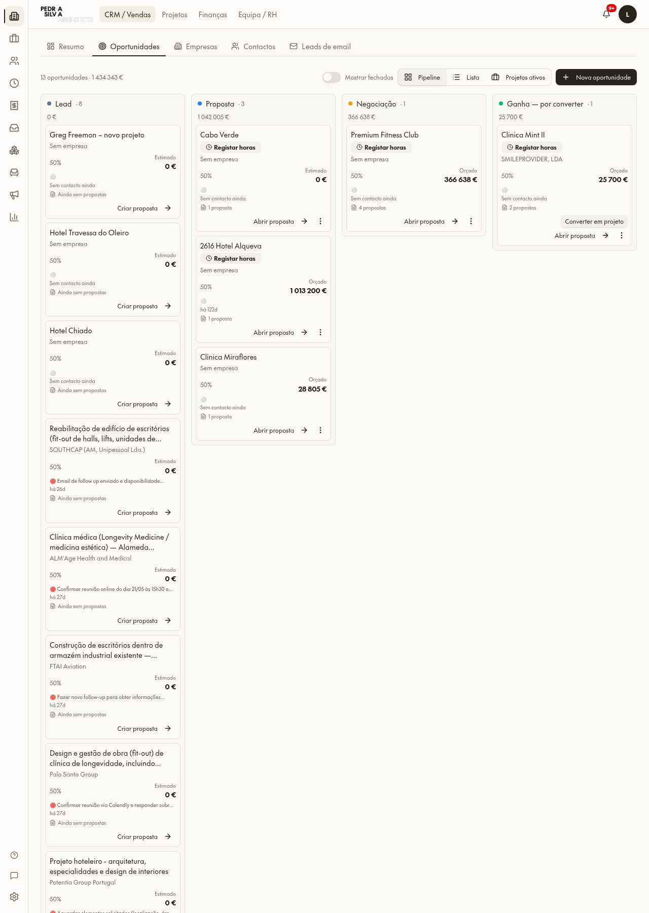
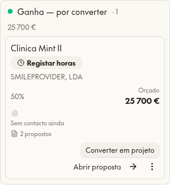
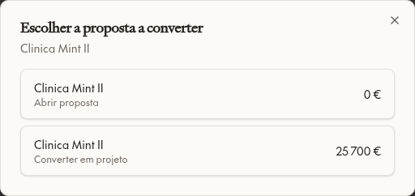
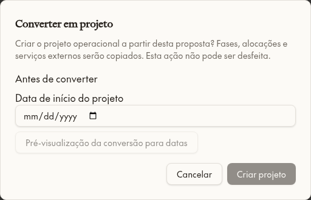
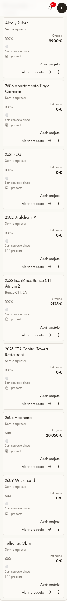
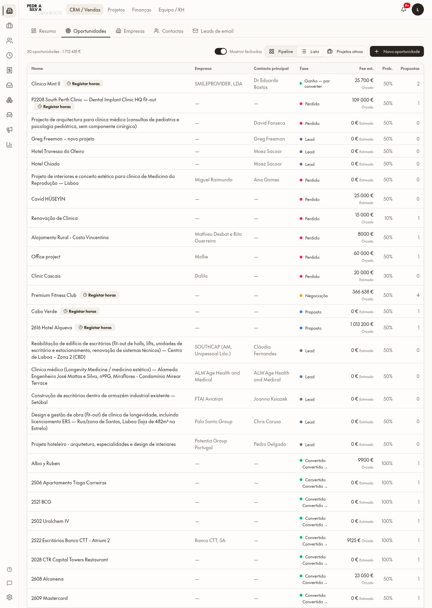
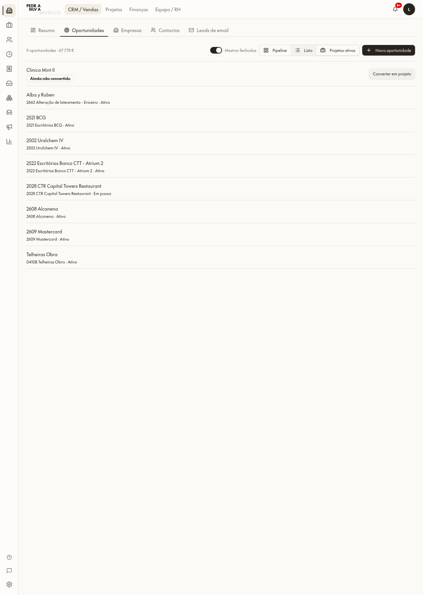

# CRM — oportunidades ganhas visíveis

3 novembro 2026. Correção exclusivamente de apresentação; sem migrações, alterações de dados ou conversões.

## Resultado
- Ganha — por converter visível por defeito, independente de Mostrar fechadas.
- Convertida é uma projeção das ligações a projetos, não um novo estado gravado. Surge com Mostrar fechadas e oferece Abrir projeto.
- As colunas e a Lista usam a mesma seleção: por defeito 13 = Lead 8 + Proposta 3 + Negociação 1 + Ganha por converter 1; com fechadas 30 = 13 + Perdida 8 + Convertida 9. Lista confirmada com 30 linhas.
- Projetos ativos mantém ativos/em pausa e a Mint por converter: 9 oportunidades. Projetos arquivados ficam fora deste separador, mas continuam acessíveis nas fechadas.
- Cabo Verde, Hotel Alqueva, Clínica Miraflores e Premium Fitness Club mostram Abrir proposta, não conversão prematura.
- Elegibilidade vem de crm_quote_lifecycle, apenas Aprovada/Assinada. Propostas múltiplas exigem escolha explícita. Cartões e página da proposta partilham QuoteConversionDialog e pm_convert_relative_quote, incluindo checklist, empresa inline, início real e pré-visualização obrigatória. Não há conversão alternativa.

## Oportunidades anteriormente ausentes das colunas
Leitura integral das dez oportunidades em `won`; todas eram excluídas do quadro anterior, mesmo com Mostrar fechadas. As nove convertidas já podiam existir na Lista/Projetos ativos; a Mint ficava fora do quadro e da Lista por defeito.

| Nome | Fase gravada | Tem projeto |
| --- | --- | --- |
| 2028 CTR Capital Towers Restaurant | Ganha | Sim |
| 2502 Uralchem IV | Ganha | Sim |
| 2506 Apartamento Tiago Carreiras | Ganha | Sim |
| 2521 BCG | Ganha | Sim |
| 2522 Escritórios Banco CTT - Atrium 2 | Ganha | Sim |
| 2608 Alcanena | Ganha | Sim |
| 2609 Mastercard | Ganha | Sim |
| Alba y Ruben | Ganha | Sim |
| Clinica Mint II | Ganha | Não |
| Telheiras Obra | Ganha | Sim |

## Ficheiros
- `src/lib/crm/pipeline-board.ts`: projeção e contagens comuns.
- `src/lib/crm/opportunity-projects.ts`: elegibilidade por lifecycle.
- `src/routes/_app.crm.opportunities.index.tsx`: colunas, consultas de lifecycle, escolha e diálogo partilhado.
- `src/components/quotes/quote-conversion-dialog.tsx`: extração do diálogo existente, sem mudar as funções da base de dados.
- `src/routes/_app.crm.quotes.$quoteId.tsx`: reutiliza o mesmo diálogo.
- `src/i18n/locales/{en,pt-PT}/crm.json`: Ganha por converter / Convertida.
- `scripts/test-crm-pipeline-board.test.ts`: visibilidade, projeção, igualdade de totais e elegibilidade.
- `src/lib/crm/AGENTS.md`, `AGENTS.md`, `roadmap.md`: regras e conclusão.
- Este relatório e `docs/crm-won-visibility/*.png`.

## Verificação e preservação
35 testes passaram (22 CRM, 13 lifecycle); paridade EN/PT e auditoria de UI sem candidatos novos; build OK.
Browser autenticado: quadro por defeito, escolha explícita da proposta Mint, diálogo protegido aberto e cancelado, fechadas, Lista e Projetos ativos. Zero erros e zero tentativas de gravação. Bloqueio adicional de gravações/conversão no browser durante os testes. Nenhuma fixture persistida e nenhuma conversão efetuada; a execução final de criação foi deliberadamente não testada neste pedido que proíbe alterar dados.

Hashes integrais antes/depois idênticos:
| Dados | Linhas | MD5 antes = depois |
| --- | ---: | --- |
| crm_opportunities | 30 | f17c1b72dd28398f685c326f2d938122 |
| fee_proposals | 35 | 740894c71ffd80c5ac28d53de6cc48a1 |
| quote_stages | 180 | 87ca58ec574857a4845011b6d031d7c1 |
| pm_projects | 20 | 96abfa1a629138640e5e6ba75be209fa |

Os valores mostrados são os valores atuais já fornecidos pelo CRM; não se corrigiram honorários nem cálculos neste pedido.

## Capturas PT

