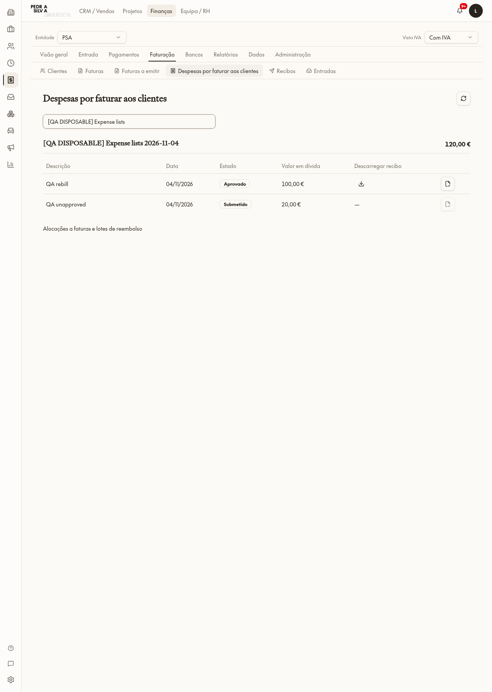
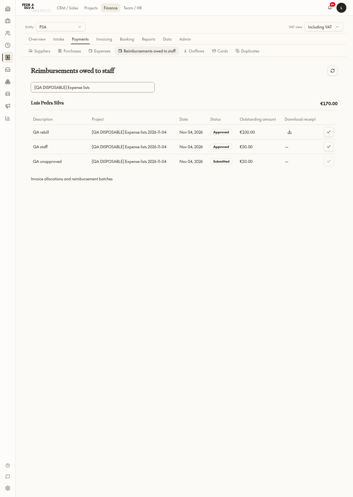
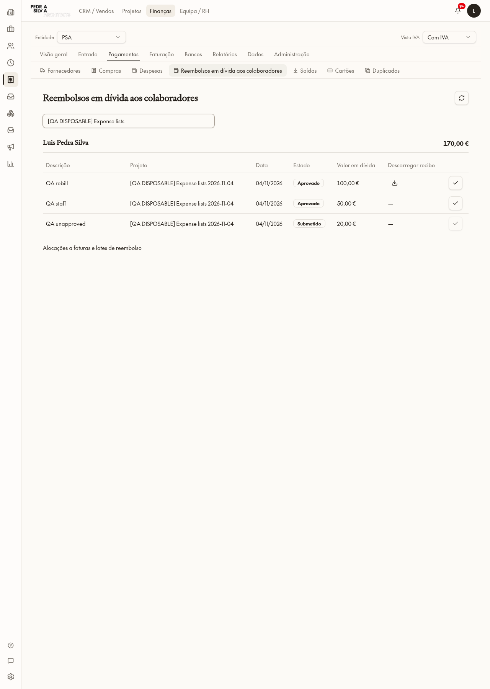
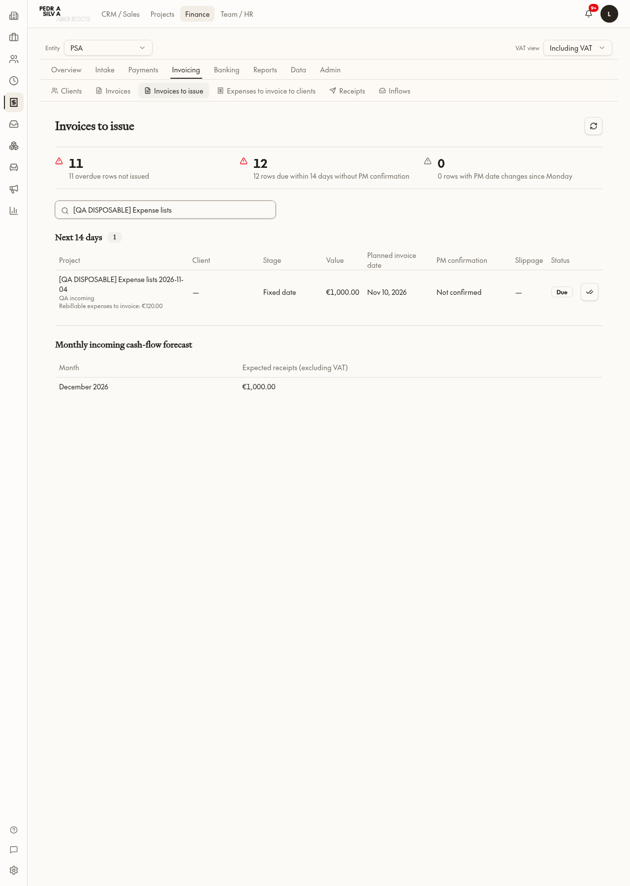
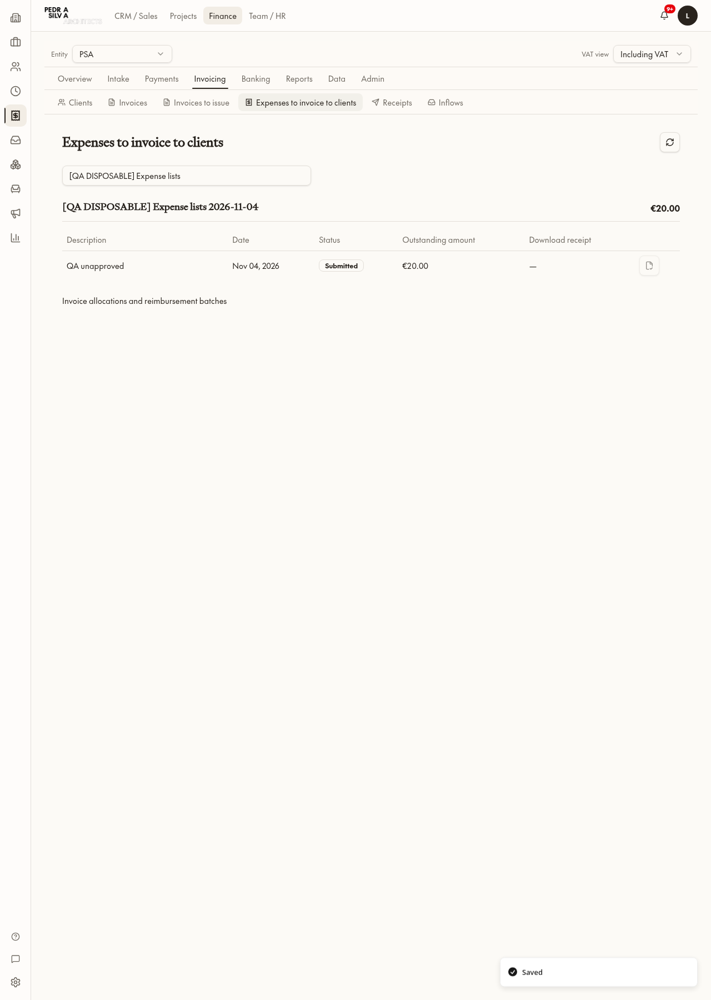
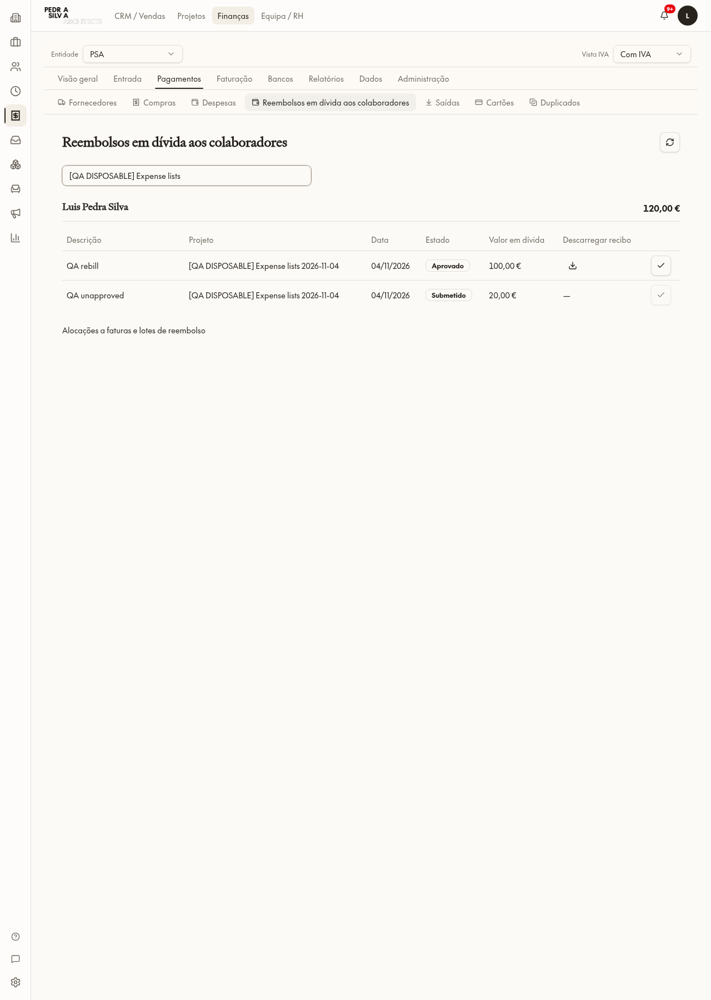
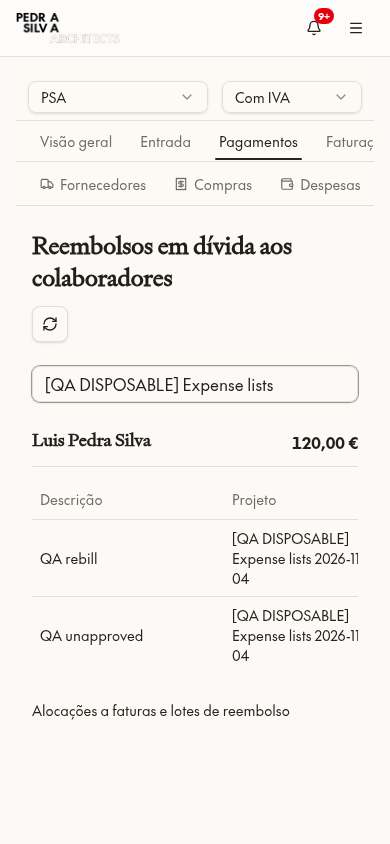

# Item 4 — Listas de despesas Finance

## Como as despesas são registadas hoje (antes do código)

- **Dono/projeto:** `pm_expenses.project_id` obrigatório; `entity_id` identifica PSA no fluxo atual. Nunca ler `company_expenses` como custos de projeto.
- **Duas versões:** `workflow_version=1` conserva história; novas despesas usam `workflow_version=2`, com recibo/intake partilhado, moeda/valor original e valor EUR (`eur_amount`) com evidência cambial. Não adaptar nem atualizar história.
- **Refaturação:** `rebillable` é o indicador legado; V2 usa `rebill_mode=none/cost/markup` e `markup_pct`, independente de quem pagou. `tax_treatment`/`tax_parameters` guardam o tratamento fiscal confirmado; `pending` não pode ser silenciosamente resolvido.
- **Pagamento pessoal:** `payment_source_type=personal` e `reimburse_collaborator_id` identificam quem pagou; `reimbursable` é mantido como indicador. Conta/cartão da empresa têm referências próprias e não geram dívida ao colaborador.
- **Aprovação:** despesa pessoal exige submissão e `approval_state=approved`; obrigação em `finance_holder_reimbursements.project_expense_id`. Não reembolsar despesas por aprovar.
- **Reembolso:** lotes `project_reimbursement_batches` e alocações `project_reimbursement_allocations` guardam reservas e valores liquidados; ligação opcional à transferência bancária. Obrigação usa `status=owed/repaid`, `repaid_at/repaid_by`; despesa usa `status=paid`, `paid_at`. Reversões são explícitas.
- **Faturação cliente:** alocações `project_expense_invoice_allocations` ligam parcelas de custo/venda/IVA a linhas de fatura; créditos e recibos têm alocações próprias. Campos existentes `invoiced_at`, `invoice_reference`, `invoiced_in_invoice_id` registam referência de faturação legada/manual. Não confundir faturado com recebido.
- **Recibo/auditoria:** `receipt_path` reutiliza o ficheiro já guardado; `project_expense_events` regista ações, autor, hora, antes/depois e evidência. Escritas V2 passam por ações guardadas, não UPDATE livre.
- **Hoje na UI:** `/finance/project-expenses` já contém listas V2 e operações detalhadas de alocação/lotes, mas não filtra corretamente apenas os saldos pendentes nem apresenta totais/recibos como as duas listas pedidas.

## Implementação

Reutilizar campos existentes, valores EUR e alocações para saldos; páginas Finance separadas agrupadas por projeto/cliente e por colaborador. Confirmação manual de refaturação usa os campos existentes de referência/data, sem criar fatura fiscal fictícia. Reembolso manual usa lote/alocação/obrigação existentes, com data em `paid_at`, sem reconciliar banco ficticiamente. Ambas as ações auditadas e restritas a Finance + Expenses do projeto, com barreiras fiscais/aprovação. Indicar totais por faturar no item 3 apenas para projetos em que o leitor também pode ver Expenses. Sem emails, sem dados reais alterados; concluir com fixtures exatas/zero e parar antes da Fase B.

## Verificação

### Implementado

- `/finance/invoicing/expenses-to-invoice`: saldo refaturável por projeto/cliente, incluindo despesas ainda a aguardar aprovação/fiscalidade (ação desativada), totais e download de recibo pelo Storage do próprio utilizador.
- `/finance/payments/staff-reimbursements`: saldo pessoal por colaborador/projeto, com ação desativada nas despesas não aprovadas ou reservadas noutro lote.
- O número manual usa **campos existentes** `invoice_reference`/`invoiced_at`, auditado em `project_expense_events`. Não fabrica documento/linha fiscal nem recibo de cliente. Despesas parcialmente alocadas continuam no fluxo detalhado, não são sobrescritas por uma referência manual. Guards impedem nova faturação/edição sobre a marca manual.
- Reembolso usa **tabelas/campos existentes**: obrigação aprovada, lote, alocação liquidada, `repaid_at/repaid_by` e `paid_at`. Evidência do evento declara `bankReconciled=false`; nenhuma transferência fictícia ou reconciliação é criada. Reversão permanece no fluxo detalhado de lotes.
- **Nenhum campo/tabela novo necessário.** Novas funções guardadas e ajustes nos guards existentes apenas. V1 é visível, mas só de leitura; não houve adaptação histórica.
- Saldos V2 usam EUR, alocações ativas e créditos; valores EUR ausentes são assinalados, não convertidos em zero. Hint no item 3 usa somente despesas de projetos autorizados pelo switch Expenses e não soma custos ao valor da prestação.
- Entrada Finance + entidade PSA + autorização Expenses na RPC e em cada ação; Patricia/entidades externas não obtêm dados. Fase B continua fora do âmbito.

### Testes realizados

Um projeto `[QA DISPOSABLE] Expense lists 2026-11-04`, três despesas sintéticas pessoais: 100 EUR refaturável/aprovada com recibo, 50 EUR não refaturável/aprovada e 20 EUR refaturável/por aprovar. O colaborador já existente apenas identificou o pagador das fixtures, sem editar o seu registo. Sem criar recursos/pessoas QA ou dados ligados a projetos reais.

- Totais iniciais: clientes **120 EUR**, pessoal **170 EUR**; agrupamento por projeto e pagador, recibo real QA descarregado, hint de **120 EUR** no item 3.
- Clique Finance «adicionada à fatura» com `QA-LISTS/1` → linha de 100 EUR saiu da lista; leitura confirmou referência e evento `manualInvoiceReference` com autor/hora.
- Clique Finance «reembolsada» em 04/11/2026 → 50 EUR saiu da lista; obrigação/alocação e evento `manualReimbursement` confirmados; saldo pessoal **120 EUR**, saldo cliente **20 EUR**.
- Despesa por aprovar recusada na RPC de reembolso; UI mantém ação desativada. Patricia recusada nas duas ações/leitura e recibo (zero bytes). Teresa recusada na leitura Finance PSA.
- EN/PT nas páginas reais, sem alterações a preferências reais; desktop 1280×1800 e mobile 390×844 verificados. Tabelas deslocam horizontalmente no mobile.
- 18 testes passaram (saldos/filtros/grupos/aprovação/valores ausentes, valores de despesas e regressão item 3). Paridade EN/PT 13 namespaces; AST zero novos literais; baseline intocado. Último sinal: build OK.
- Preparação: inserção QA sem entidade foi recusada pelo trigger existente (repetida com entidade explícita, sem o alterar); local antigo `e` em `pe_action` corrigido para `v_expense` na migração 0254; erro JSX e seletores demasiado amplos corrigidos. Nenhuma tentativa falhada é apresentada como verificação concluída.

### Limpeza

Snapshot exato antes de apagar em `/tmp/browser/expense-lists/exact-snapshot.json`; contém IDs de sessões existentes, pelo que não é publicado. Recibo QA apagado pelo próprio cliente Storage. Limpeza transacional por IDs/nome exatos, sem desativar triggers, conforme `finance-expense-lists/exact-fixture-cleanup.sql`; só as três fixtures mudaram temporariamente para o ramo V1 de eliminação no mesmo transaction.

Leitura independente **2026-11-04 02:02:06.141698 UTC**: projeto=0, despesas=0, obrigações=0, eventos=0, lote=0, alocações=0, objetos=0, incoming=0. Fase A permaneceu **ON**. Não foram feitas escritas em registos reais; não se afirma uma comparação integral antes/depois, que não foi persistida nesta sessão de teste. Nenhum check Finance anteriormente recusado foi repetido.

### Ficheiros

- `src/components/finance/expense-pending-lists.tsx`
- `src/lib/finance/expense-pending-lists.ts`, `use-expense-pending-lists.ts`
- `src/routes/_app.finance.invoicing.expenses-to-invoice.tsx`, `_app.finance.payments.staff-reimbursements.tsx`
- `src/components/finance/finance-nav-config.ts`, `invoices-to-issue.tsx`
- `src/routes/_app.finance.invoicing.to-issue.tsx`
- `src/i18n/locales/{en,pt-PT}/finance.json`
- `scripts/test-expense-pending-lists.test.ts`
- Migrações 0252 (listas/ações), 0253 (EUR ausente/guard de emissão), 0254 (variáveis da função), aplicadas e espelhadas idênticas em `drizzle/migrations` e `supabase/migrations`.
- `AGENTS.md`, `roadmap.md`, este relatório e capturas `docs/finance-expense-lists/`.
- Limpeza DML exata guardada em `docs/finance-expense-lists/exact-fixture-cleanup.sql`; não é alteração de esquema.

### Capturas

Item 4 terminado; **parar e aguardar Luis**, sem iniciar Fase B.