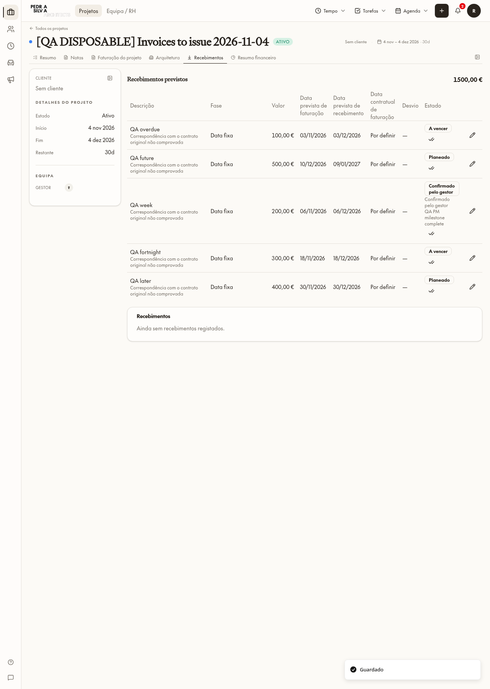
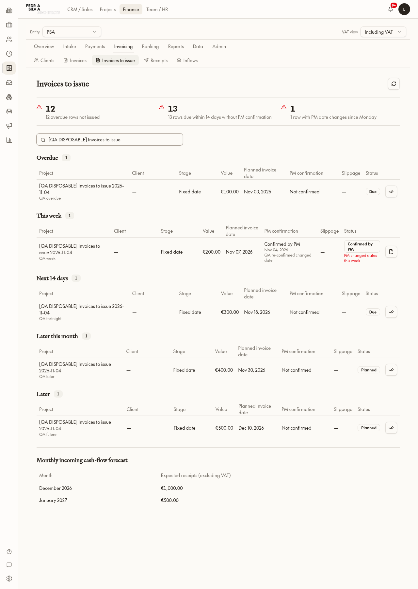
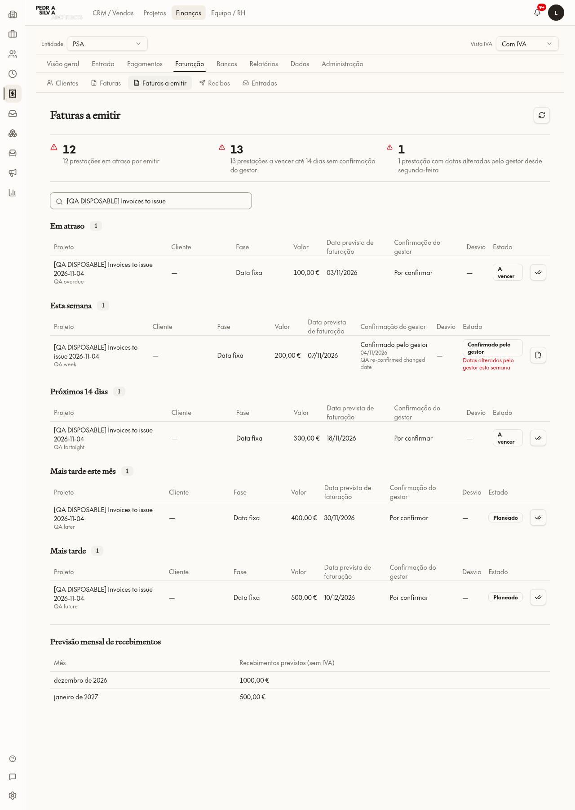
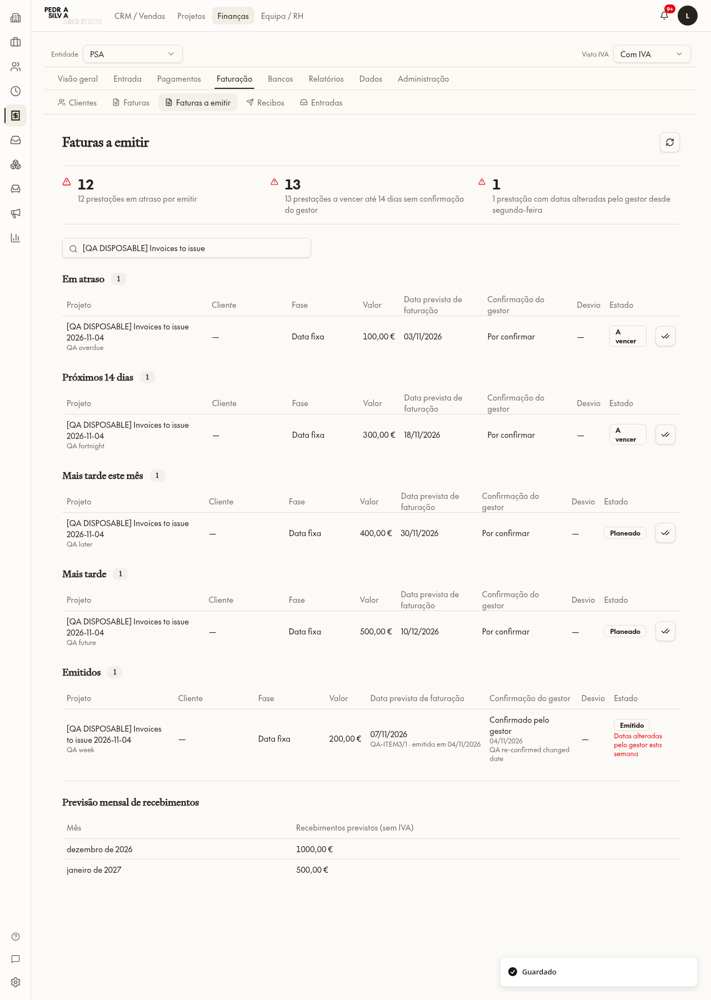
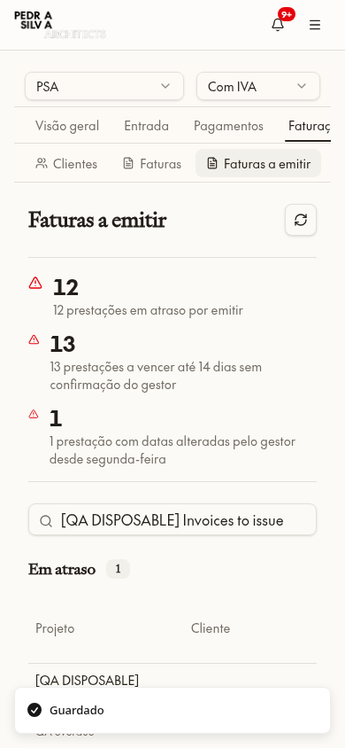

# Item 3 — Faturas a emitir

## Plano de implementação (registado antes do código)

1. Criar página Finance «Faturas a emitir», com entrada restrita ao módulo Finance e leituras limitadas aos projetos Financials autorizados; os valores/datas operacionais vêm exclusivamente de `pm_project_incoming_timing`.
2. Acrescentar confirmação «Pronto a faturar» no separador Recebimentos do projeto, pelo helper de datas ou Finance, com nota opcional e auditoria de autor/hora. Não altera valores, IVA ou termos.
3. Guardar emissão manual com número/data por ação fiscal autorizada e auditada; reutilizar congelamento do item 2. Estados de apresentação: Planeado → A vencer (até 14 dias, inclusive, ou passado) → Confirmado pelo gestor → Emitido → Pago. Pagamentos reais continuam no fluxo existente.
4. Agrupar pendentes por Em atraso / Esta semana / Próximos 14 dias / Mais tarde este mês; incluir estados emitidos/pagos e datas indefinidas em vistas explícitas, sem esconder história ou inventar datas. Mostrar cliente, fase, montante, datas, confirmação e desvio contratual.
5. Avisos: vencidos não emitidos, até 14 dias sem confirmação e alterações de datas por gestores desde segunda-feira desta semana (Lisboa). Sem emails.
6. Previsão mensal por data esperada de pagamento da projeção do item 2, preservando offsets, overrides e datas congeladas. Valores pagos não entram em recebimentos futuros.
7. Adicionar EN/PT, testes unitários e testes completos num único projeto descartável; snapshots, eliminação exata e zero independente. Guardar capturas e ficheiros alterados neste relatório. Sem dados reais alterados e sem implementar Fase B.

## Decisões técnicas

- Confirmação e emissão são ações de base de dados com autorização por projeto, bloqueio da linha e auditoria, não atualizações livres do navegador.
- A projeção existente mantém a propriedade dos cálculos; a página não lê datas da proposta nem recalcula recebimentos por outra fonte.
- Confirmar requer data operativa válida; alterações posteriores da data tornam a confirmação anterior desatualizada, sem apagar auditoria.

## Execução

### Resultado

- Página `/finance/invoicing/to-issue`, na navegação Faturação → Faturas a emitir. A entrada Finance existente permanece; a RPC exige Finance, entidade PSA selecionada e acesso Financials de cada projeto. Sem fallback privilegiado no navegador.
- Leituras de montantes/datas exclusivamente por `pm_project_incoming_timing`; nomes de projeto/cliente vêm dos respetivos registos ligados. Fases numeradas pelo helper WBS partilhado.
- Recebimentos do projeto: botão «Pronto a faturar», nota opcional, auditoria de autor/hora; os estados de apresentação usam a data de Lisboa devolvida pela projeção. Confirmar não modifica a prestação financeira.
- Confirmação vinculada a datas operacionais de fatura/pagamento e valor. Se mudarem, aparece «Confirmação a rever» e emissão recusa a confirmação antiga. Nova confirmação mantém os eventos anteriores.
- Emissão manual regista número/data/autor/hora, verifica confirmação atual e passa a prestação a `issued`. O trigger existente congela as datas planeadas, não as substitui pela data efetiva de emissão. Exemplo QA: emissão em 04/11, plano congelado em 07/11, pagamento congelado em 07/12. Repetir o mesmo número/data é idempotente; outro número já registado neste fluxo é recusado.
- Este é um registo manual de emissão da prestação, não emissão legal de PDF nem integração InvoiceXpress. Faturação documental, SAF-T e pagamento confirmado continuam nos fluxos existentes; a página não inventa recibos nem marca recebimentos pagos.
- Avisos globais não são reduzidos pela pesquisa; grupos e previsão refletem a pesquisa. Previsão apresentada sem IVA, explicitamente identificada, por data esperada de pagamento do item 2; overrides/freeze prevalecem sobre invoice+offset. Pagos/cancelados excluídos, datas indefinidas assinaladas.
- Alterações de datas por gestor desde segunda-feira: auditoria passa a guardar evidência do papel do autor no momento da alteração. História anterior à nova coluna usa associação atual como fallback e não foi alterada. Não são enviados emails nem criadas notificações externas.

### Verificação completa na aplicação

Teste final num único projeto descartável, com cinco prestações sintéticas (100/200/300/400/500 EUR), sem proposta, cliente, fases, horas ou ficheiros reais copiados. Rita foi gestora apenas desta fixture pela ação de equipa existente; não foi criada identidade/recurso QA.

1. Patricia: RPC da página, confirmação e emissão recusadas. Teresa: RPC Finance PSA recusada. Rita gestora Financials ON: página Finance recusada, confirmação na página real de Recebimentos permitida.
2. Clique na prestação exata QA week → nota → guardar → leitura independente confirmou autor, nota e confirmação atual.
3. Alteração auditada por Rita: 06/11 → 07/11. Confirmação tornou-se desatualizada; emissão recusada até nova confirmação; aviso de alteração desde segunda-feira contou uma prestação.
4. Página real Finance EN/PT, pesquisa apenas QA, quatro grupos pedidos e futuro adicional visíveis; previsão dezembro 1 000 EUR / janeiro 500 EUR.
5. Diálogo Finance → número `QA-ITEM3/1` / emissão 04/11 → guardar → leitura independente `issued`, freeze 07/11 e 07/12; posterior alteração de datas recusada. UPDATE direto de readiness recusado.
6. Captura 390×844: avisos legíveis e tabelas com deslocação horizontal; desktop 1280×1800 sem sobreposições.
7. Cinco testes unitários passaram: limite inclusivo de 14 dias, prioridades dos estados, grupos disjuntos, avisos e forecast por data de pagamento. Paridade EN/PT em 13 namespaces e AST: zero novos literais; baseline intocado. Último estado observado: build OK.

Tentativas preparatórias terminaram sempre com eliminação da fixture antes de repetir: seleção de linha instável (corrigida para ID/label exato), coluna de cliente `name` inexistente (corrigida para `nome` na migração 0250), seletores de idioma e diálogo demasiado amplos. Não foram tratadas como aprovação e não houve mudança de dados reais.

### Limpeza e preservação

- Snapshot completo da fixture antes de eliminar em `/tmp/browser/invoices-to-issue/fixture-snapshot.json`; não anexado por conter identificadores das sessões/equipa.
- Eliminação exata do projeto pelo ID e nome QA; cascades eliminaram prestações, equipa/acesso e auditorias da fixture. Nenhum Storage usado.
- Leitura independente **2026-11-04 01:50:10.004094 UTC**: projects=0 (ID e nome QA), payments=0, readiness=0, workflow_audit=0, date_audit=0, team=0, access=0. Gate Fase A permaneceu **ON**.
- Comparação completa antes/depois das tabelas reais de projetos/fases/alocações/horas/recebimentos/faturas/documentos/linhas/despesas/equipa/acessos/capacidades: igualdade exata. Não foram repetidos os checks Finance recusados.
- Tabelas novas: authenticated apenas SELECT, anon sem privilégios; auditoria com RLS/imutabilidade e TRUNCATE revogado. Defaults postgres e grants existentes foram consultados; nenhuma concessão a tabelas antigas foi alterada.

### Ficheiros

- `src/components/finance/invoices-to-issue.tsx`
- `src/routes/_app.finance.invoicing.to-issue.tsx`
- `src/lib/finance/invoices-to-issue.ts`, `use-invoices-to-issue.ts`
- `src/components/projects/project-incoming-payments.tsx`, `src/lib/projects/payment-timing.ts`
- `src/components/finance/finance-nav-config.ts`
- `src/i18n/locales/{en,pt-PT}/finance.json`
- `scripts/test-invoices-to-issue.test.ts`
- Migrações `0248_incoming_invoice_readiness_and_issue.sql`, `0249_invoice_workflow_direct_write_boundary.sql`, `0250_invoice_queue_client_name_column.sql`, `0251_invoice_timing_today_and_stage_tree.sql`, aplicadas e idênticas em `drizzle/migrations` e `supabase/migrations`.
- `AGENTS.md`, `roadmap.md`, este relatório e `docs/finance-invoices-to-issue/`.

### Capturas

Capturas das páginas reais, não componentes isolados. Idioma alterado somente em memória no navegador; sem guardar preferências reais.

Fase B não implementada. Este relatório não afirma que as restantes superfícies globais/mistas ficaram protegidas por este trabalho.