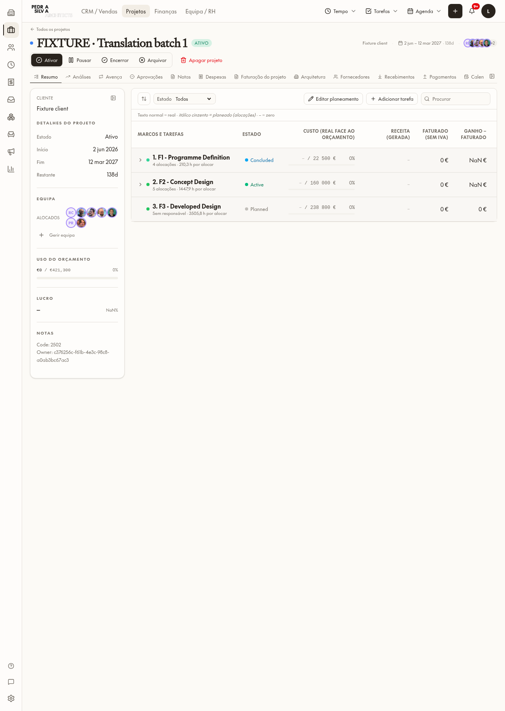
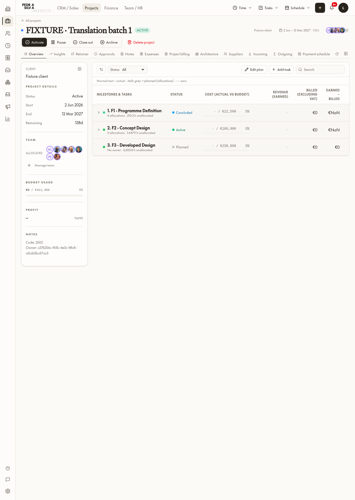

# Translation batch 1 — Projects routes

## Result

Projects-route checker candidates: **378 → 26** (352 resolved occurrences removed from the baseline; no new allowances). Whole-app count: **2,837 → 2,485**. EN/PT parity passes across all 12 namespaces; `npm run test:i18n`: nine tests passed, ratchet passed. Latest preview build: OK.

| Route | Before | After |
|---|---:|---:|
| `_app.projects.$projectId.tsx` | 128 | 18 |
| `_app.projects.approvals.tsx` | 2 | 0 |
| `_app.projects.financials.tsx` | 1 | 1 |
| `_app.projects.forecast.tsx` | 51 | 0 |
| `_app.projects.gantt.tsx` | 32 | 0 |
| `_app.projects.my-tasks.tsx` | 55 | 5 |
| `_app.projects.resources.$resourceId.tsx` | 35 | 0 |
| `_app.projects.resources.tsx` | 36 | 0 |
| `_app.projects.timesheet.tsx` | 34 | 2 |
| `_app.projects.weekly-approval.tsx` | 4 | 0 |

Routes with no checker candidates before or after: project allocations, project dashboard/index, project insights and weekly planning. They were reviewed; weekly planning now uses the existing date-locale helper. The Finance route is restored **byte-for-byte to its pre-batch snapshot**, including pending work.

## Changed files

- `src/routes/_app.projects.$projectId.tsx`, `.allocations.tsx`, `_app.projects.approvals.tsx`, `_app.projects.forecast.tsx`, `_app.projects.gantt.tsx`, `_app.projects.insights.tsx`, `_app.projects.my-tasks.tsx`, `_app.projects.resources.tsx`, `_app.projects.resources.$resourceId.tsx`, `_app.projects.timesheet.tsx`, `_app.projects.week-plan.tsx`, `_app.projects.weekly-approval.tsx`.
- `src/i18n/locales/{en,pt-PT}/{projects,common}.json`: translated route text, constants, interpolation and plural variants; reused canonical glossary keys. Existing Projects PT spelling normalized to AO90. No document translations.
- `scripts/i18n-baseline.json`: subtract resolved route signatures only.
- `AGENTS.md`, `roadmap.md`, this report and bilingual screenshots.
- No database changes or migrations.

## Deliberately retained

- 18 project-detail checker expressions are tab identifiers inside render guards (e.g. `overview`, `billing`, `insights`), not visible copy.
- Five my-tasks expressions are stored status comparisons (`pending`, `active`, `paused`, `done`), not visible labels.
- Two timesheet candidates: `not_connected` is a comparison enum and `0h00` is a compact time-editor placeholder.
- One Finance candidate, “of total time”, plus its pre-existing fixed display formats: protected pending Finance work was explicitly excluded rather than modified.
- Stage status labels “Concluded/Active/Planned” visible in PT come from `components/projects/stage-status-cell.tsx`, outside this **routes-only** batch; left for the components batch. No stored stage names, clients, notes or document content translated.
- Existing components outside the requested routes may still show mixed-language copy (including shell/dashboard text); not broadened into this batch.
- Project-detail financial NaN displays were observed in the local copied fixture with incomplete related financial data. No calculations changed to conceal them.

## Browser verification

Authenticated detail, forecast and my-tasks opened at their expected URLs in both PT-PT and EN. No raw translation keys and no page errors. Forecast legend now changes Revenue/Cost/Profit and Receita/Custo/Lucro; dates and route-owned numbers follow the active language.

The detail page used a disposable **browser-response copy**, UUID `00000000-0000-4000-8000-00000000b101`, labelled FIXTURE. Read original data once into copied responses, never inserted or changed a live project. All direct database writes were blocked; zero attempted direct writes. Read-only permission/query RPCs remained available. Language changed on the local i18n instance, not on the collaborator profile. Browser closure removed the fixture; nothing required deletion in the database. My-tasks was inspected only, never accepted, paused or logged.

### Project detail — Português

### Project detail — English

