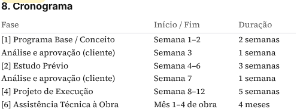
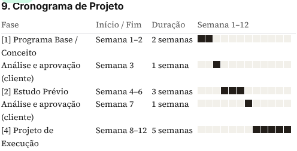
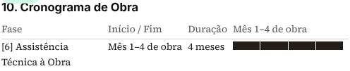
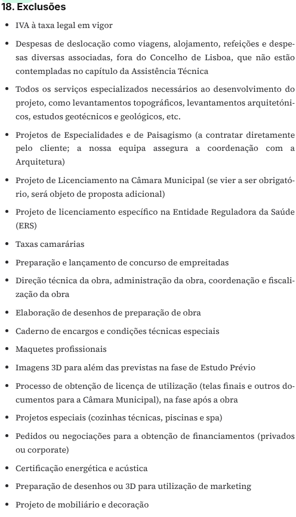
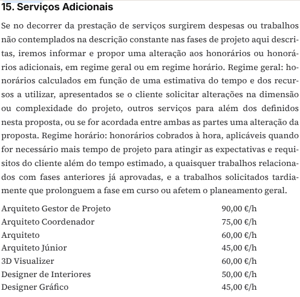

# Clínica Mint II — conteúdo REV 01

Proposta autorizada: `37ebfc12-6717-474f-a5f4-5887706f7250`.
Documento: `20c4c8b3-c84b-4297-aabb-bc5d17414d84`.

## Alterações realizadas

- Capa: **Ampliação Clínica Dentária Mint**, **Avenida Marquês de Tomar 5, Lisboa**, referência **P2603**. Cliente vazio sem travessão; número **2680** e data **22/10/2026** mantidos pela lógica existente.
- Âmbito substituído integralmente pelo texto fornecido, incluindo a área de **270 m²**, sem «anteprojeto».
- Cronograma e resumos: Execução **5 semanas**, **Semana 8–12**; Assistência **4 meses**, **Mês 1–4 de obra**.
- Cronograma de Projeto preenchido com semanas **1–12**, incluindo as duas semanas de análise/aprovação do cliente; Cronograma de Obra preenchido com meses **1–4**. Não são usadas datas nem um início fictício.
- Assistência colocada imediatamente após Execução, antes do Cronograma; Validade e Aceitação permanece no final.
- Validade substituída por **60 dias**; Suspensão ou Rescisão e Serviços Adicionais substituídos pelos textos fornecidos.
- Exclusões: **19 itens**, incluindo os licenciamentos municipal e ERS fora do âmbito; tabela de **7 valores horários** conforme REV 01.
- Textos das quatro fases preservados integralmente, incluindo referências já existentes a licenciamento na descrição de Programa Base, como solicitado. Apenas dois campos de apresentação da duração foram acrescentados.

## Limites e provas antes → depois

**Honorários e pagamentos: 30 980 € → 30 980 € sem IVA.** Nenhuma linha de pagamento, verba, IVA, orçamento, data ou fase do Gantt foi alterada. Os cronogramas são instruções relativas guardadas apenas neste documento; o Gantt e a conversão mantêm o seu comportamento existente.

| Âmbito protegido | Hash MD5 antes = depois |
|---|---|
| Todas as outras propostas do construtor | `b430df12e844c1e36105ac35b68e5585` |
| Todos os outros blocos | `5f889abc75022d6b2ecc0c7511b71777` |
| Todas as propostas comerciais | `0d694bc2534fa7e3b350eff45aae63ef` |
| Todas as fases, incluindo Mint | `87ca58ec574857a4845011b6d031d7c1` |
| Todos os planos de pagamento | `b5811f5ce98e004da454f7db7237a2b5` |
| Conteúdo das quatro fases, excluindo apenas o novo campo de duração | `2b46df43003b56fde9db5ff6f5cd9775` |

Atualizados **11 blocos próprios deste documento**, numa operação delimitada pelo documento/proposta desbloqueados, contagem esperada e preservação dos restantes blocos/textos. A formatação final das exclusões foi corrigida numa segunda operação apenas sobre esse bloco.

Registo idempotente do estado final em **0216_mint_rev01_document_content.sql**, espelhado byte a byte em `supabase/migrations` e `drizzle/migrations`; sem alterações de esquema nem modelos reutilizáveis. A apresentação só muda nos blocos que contêm os novos campos explícitos; os restantes continuam a usar os valores anteriores.

## Validação

- **7 testes** aprovados: 3 de cronograma relativo e 4 de timing do plano de pagamentos.
- Auditoria i18n: **13 testes do checker + 9 testes de erros**, paridade EN/PT em 13 namespaces, **0 candidatos UI**.
- Pré-visualização autenticada leu o documento guardado: capa, cronogramas, dois resumos, 19 exclusões, tabela de serviços e validade verificados; **0 erros de runtime**.
- Verificação exclusivamente de leitura: bloqueada a criação automática de um snapshot ao abrir o construtor; não houve submissão, envio, aprovação ou alteração de dados pelo browser.
- Compilação mais recente: **build OK**.
- Não foram criados testes em propostas reais; os testes de lógica usam valores locais descartáveis. As capturas são leitura da correção real explicitamente autorizada.
- Não foi realizado envio, publicação ou exportação PDF. Nenhuma proposta financeira pendente foi aplicada.

## Capturas PT

### Capa

### Cronograma

### Exclusões

### Serviços Adicionais

## Ficheiros

`src/lib/psa-proposal/relative-programme.ts`, `src/components/psa-composer/block-renderer.tsx`, `scripts/test-relative-programme.test.ts`, migração 0216 nas duas pastas, `AGENTS.md`, `roadmap.md` e este relatório/capturas.