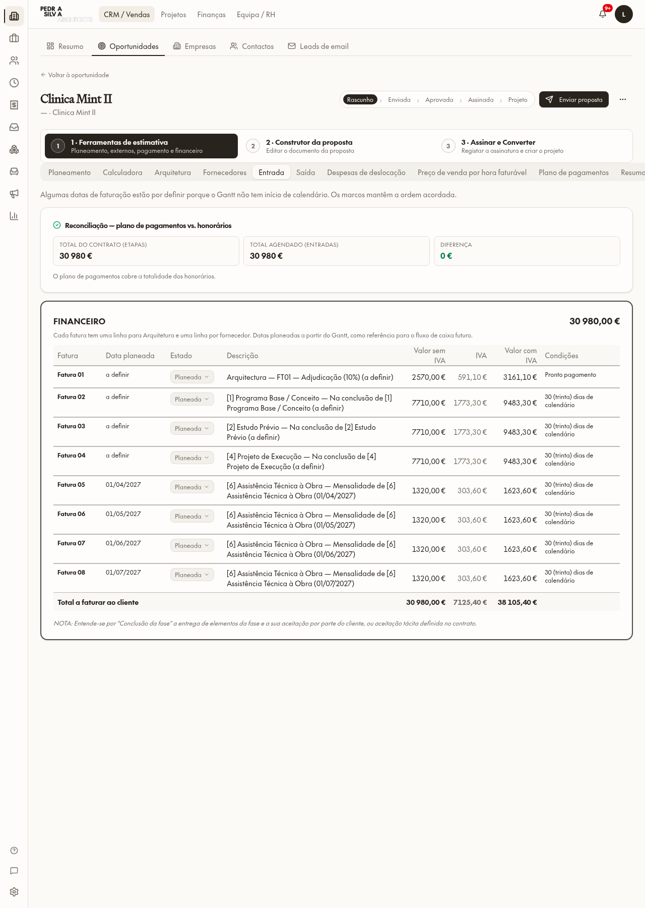
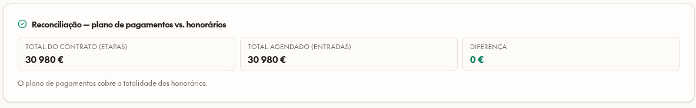

# Clínica Mint II — payment plan correction

Authorized quote: `37ebfc12-6717-474f-a5f4-5887706f7250`; composer: `20c4c8b3-c84b-4297-aabb-bc5d17414d84`.

## Before → after (excluding VAT)

| Item | Before | After |
|---|---:|---:|
| Design fee | €25,700 | €25,700 |
| Assistance, four months | €5,280 | €5,280 |
| Contract total | €30,980 | €30,980 |
| Scheduled total | €34,078 | €30,980 |
| Reconciliation difference | +€3,098 | €0 |
| Adjudication | €3,098 added on top | €2,570 included |

Corrected plan: FT01 adjudication 10% of design subtotal (€2,570); FT02 Programa Base completion, FT03 Estudo Prévio completion and FT04 Projeto de Execução completion each 30% (€7,710); FT05–08 assistance €1,320 each. Existing VAT 23% retained: net €30,980, VAT €7,125.40, gross €38,105.40.

No calendar start exists: the first four invoice/payment dates are undefined rather than fabricated. The expressly configured assistance anchor remains April–July 2027. Gantt phase dates, durations, budgets, allocations and fees were not changed.

## Cause and correction

- The stored `deductDownPaymentFromStages:false` made the generator add the advance to all full stage fees. New generation always treats advances as inclusive instalments, proportional to design fees; monthly retainers remain intact.
- Both refresh entry points now resolve `quote_build_settings.designMilestones`: percentage, label, trigger and stage anchor. Enabled percentages must total exactly 100. Fixed generated amounts resolve against the current design subtotal, not the individual phase fee or assistance total.
- A milestone editor in **Plano de pagamentos** supports adding/removing milestones, choosing adjudication/start/completion, and changing the percentage of design fees. Saving terms is separate from applying them through Update from Gantt.
- Relative planning anchors before 2010 are never generated as actual invoice dates. Both Entrada and the live composer preserve separate undefined-date milestones and their saved order instead of merging them or moving adjudication after assistance. Entrada displays an undefined-date warning and the reconciliation card.
- Removed the sole quote-specific Sustentável.pt 5% markup row and the empty live consultants block. There were already zero external services and zero supplier payment lines. The live document reads the corrected plan; issued/frozen historical snapshots were not rewritten.

## Authorized data operation

One guarded transaction updated only this quote's build settings and planned schedule, retained four monthly rows, reused four milestone rows, removed four obsolete split/zero rows, removed the exact supplier markup and the exact empty consultant block. It required the original total €34,078 and all rows planned/non-manual before proceeding, and asserted the resulting eight-row total €30,980. No schema changes or migrations were necessary; JSON settings and existing payment columns support the feature.

Full-row MD5 equality before/after:

| Scope | Unchanged hash |
|---|---|
| All other quotes | `0ab70d60b95851527c873185c6ec3adc` |
| All other quote payment plans | `cb46c91e6c0f7bcf0c5a7766671483cc` |
| All quote stages, including Mint | `87ca58ec574857a4845011b6d031d7c1` |
| All other composer blocks | `5f889abc75022d6b2ecc0c7511b71777` |

## Validation

- 17 focused tests passed: nine new milestone/date/inclusive-advance/supplier regressions, three existing proportional-advance checks and five leaf-fee tests.
- i18n tests: 13 checker tests and nine error-translator tests passed; EN/PT parity across 13 namespaces; zero UI candidates.
- Authenticated UI readback of the real authorized correction: Entrada shows FT01 €2,570, FT02–04 €7,710, four €1,320 monthly rows, total €30,980 and difference €0. No test writes to real records.
- Both refresh buttons exercised with browser-local disposable copies: intercepted every payment deletion/insertion and all other data writes. Both produced exactly `[2570,7710,7710,7710,1320,1320,1320,1320]`, undefined first-four dates and existing April–July dates, with no supplier outflows. Browser contexts destroyed; no persisted fixtures to clean up.
- Live composer readback: fee table €30,980; FT01–08 and matching total; no Sustentável.pt, administration fee or empty consultant section in the document. The block library still legitimately offers reusable consultant blocks.
- Latest preview compilation: build OK.

## Changed source

`src/lib/quotes/payment-generators.ts`, `src/lib/quotes/use-sync-quote-payment-schedule.ts`, `src/components/quotes/design-milestone-editor.tsx`, `src/components/quotes/quote-payment-schedule-tab.tsx`, `src/components/quotes/payment-schedule-proposal-view.tsx`, `src/lib/psa-proposal/live-data.ts`, paired CRM locale files, `scripts/test-design-milestones.test.ts`, `AGENTS.md`, `roadmap.md`.

## Portuguese screenshots

No publishing, proposal sending, other proposal correction, project data alteration or pending Finance operation was performed.