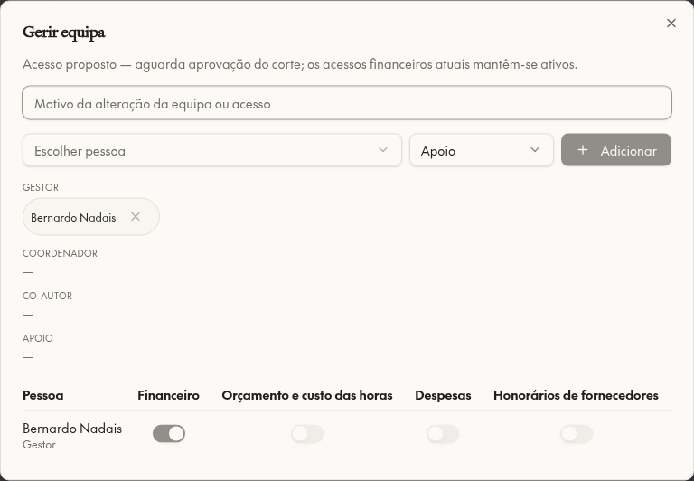
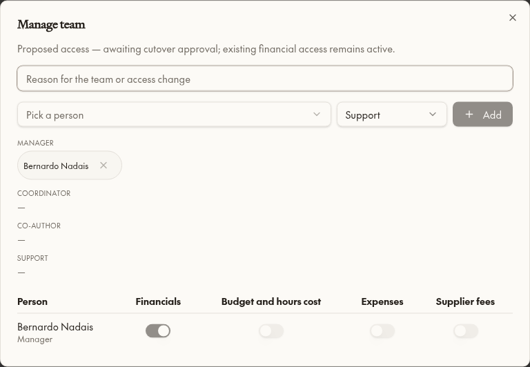

# Item 5 — Fase A preparada, corte NÃO aplicado

3 novembro 2026. Após limpeza e item 2. Tabelas de acesso e auditoria, ações admin/defaults e equipa com quatro switches propostos implementados. Não atribuí Rita/Mint; nenhuma linha real de equipa/acesso foi alterada.

## Ponto de aprovação
`pm_project_access_cutover_active()` = **false**. Switches dizem explicitamente “Acesso proposto”; políticas financeiras anteriores permanecem efetivas. Fechado já o caminho de autoatribuição: team_write removido; alterações de equipa exigem ação auditada e admin. Esta segurança administrativa não ativa o corte financeiro.

A matriz completa está em [access-matrix.csv](project-access-phase-a/access-matrix.csv): **14 contas × 21 projetos × 4 áreas = 1 176 linhas**. Expõe predicado atual de faturas, predicado financeiro global legado, resultado proposto e perda potencial. Não trata SELECT demasiado amplo como autorização legítima nem aplica automaticamente grants legacy.

### Resumo das perdas potenciais
| Pessoa | Projetos com acesso atual a faturas | Projetos com Financeiro proposto | Combinações área/projeto potencialmente perdidas |
|---|---:|---:|---:|
| Adalberto Duarte | 0 | 0 | 0 |
| Bernardo Nadais | 4 | 1 | 3 |
| Francisco Oliveira | 0 | 0 | 0 |
| Irene Cunha | 21 | 0 | 84 |
| João Almeida | 0 | 1 | 0 |
| Luis Pedra Silva | 21 | 21 | 0 |
| Mariana Oliveira | 0 | 0 | 0 |
| Patricia Reis | 3 | 0 | 3 |
| Ricardo Cabrita | 0 | 0 | 0 |
| Ricardo Conceição | 21 | 1 | 20 |
| Rita Saragoça | 0 | 0 | 0 |
| Tatiana Shchenina | 21 | 21 | 0 |
| luispedrasilva@gmail.com | 0 | 0 | 0 |
| teresa@pedrarioja.com | 0 | 0 | 63 |

**Atenção:** linha Teresa mede a exposição do helper legado, não acesso autorizado ao projeto PSA. A matriz é uma prévia de predicados; avaliação de políticas dependentes do seletor de entidade, despesas próprias/aprovações e identidade ambígua exige validação final por superfície antes de autorizar o corte. Não aprovar perdas em bloco sem escolher preservações/exceções. Luis e Tatiana mantêm tudo por permissões protegidas; sem nomes/IDs no código de autorização. Nenhum conflito de múltiplos gestores encontrado (lista vazia).

## Preparado
- `pm_project_person_access`: quatro flags, proveniência/revisão, autor/motivo. `pm_project_access_audit` append-only. Grants/RLS/revoke TRUNCATE explícitos.
- Defaults novos: gestor Financial ON, outros OFF; membro/apoio/coordenador/coautor todos OFF. Gestores históricos sem linha têm somente prévia Financeiro ON; sem backfill nem escolha automática.
- Gestor nomeado e flags apenas ações admin auditadas, revisão otimista em flags; papel manager conflituante rejeitado.
- Helper central datas preparado para Finance OR gestor próprio com Financial ON quando gate estiver ativo.
- Políticas restrictivas **inativas por gate** em pm_invoices, itens, pm_payment_schedule_items, baseline e filhos, pm_expenses e pm_stage_supplier_costs. UI dos switches disponível ao admin; ocultação de tabs por área ainda **não ativada**.

## Não ativar ainda / pendências antes do corte
A implementação não constitui cobertura financeira completa: projeção item 2 ainda precisa cortar leitores legados no momento aprovado; completar demais filhos/anexos/fornecedores/saídas e RPCs SECURITY DEFINER antes de efetivar isolamento; novos grants por área precisam substituir políticas permissivas antigas para conceder a um PM sem permissões globais. Ativar apenas o gate agora não basta. Navegação e deep links continuam regras anteriores até essa conclusão/aprovação.

Fase B não construída: SELECTs mistos pm_projects/pm_stages/propostas/horas/recursos, overview/cabeçalho/budget/insights/avença/inspetor, global Gantt e home strips, forecast, reports, pesquisa, exports/PDFs, texto de documentos/notas e URLs. Estas superfícies podem revelar valores apesar das futuras flags; não afirmar isolamento total na Fase A.

## Testes e evidência
Fixture única eliminada: manager Financial ON, restantes OFF; alteração proposta de Expenses; revisão antiga negada; INSERT direto de papel negado mesmo para admin fora da ação; auditoria não editável. Admin UI PT/EN capturada na fixture; nenhum switch real alterado. Bernardo date-only helper testado na fixture (sem Finance global): override permitido, montante e team change negados e outra Mint negada.
Nove testes permanentes + parity/AST sem novos literais + build OK. Não houve teste simultâneo de concorrência nem corte simulado com contas reais. Leitura zero em 20:40:42 UTC: **projects/proposals/opportunities/allocations=0/0/0/0**, access rows=0, audit=0.

## Ficheiros e migrações
0225 staging, 0226 identidade matriz, 0227 gate financeiro; mirrors `supabase/migrations/2026110320{38,40,43}00_*.sql`; tipos regenerados. `src/lib/projects/use-project-access.ts`, `use-project-team.ts`, `src/components/projects/project-team-card.tsx`; traduções EN/PT projects, AGENTS, roadmap.

**Aguardar Luis:** rever perdas e indicar preservações; não foi aplicado corte nem concedido acesso a Rita/Mint.
