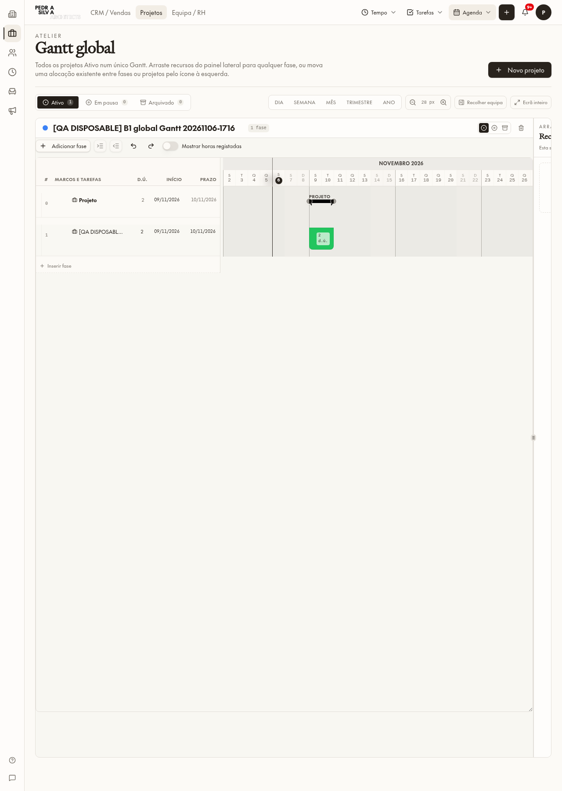
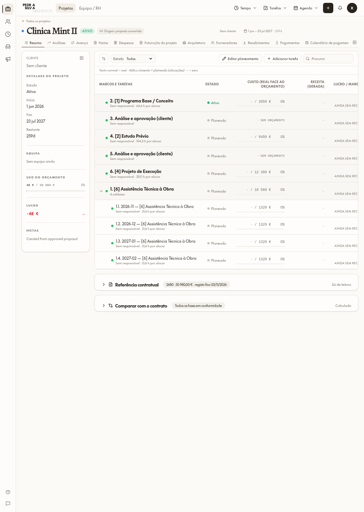
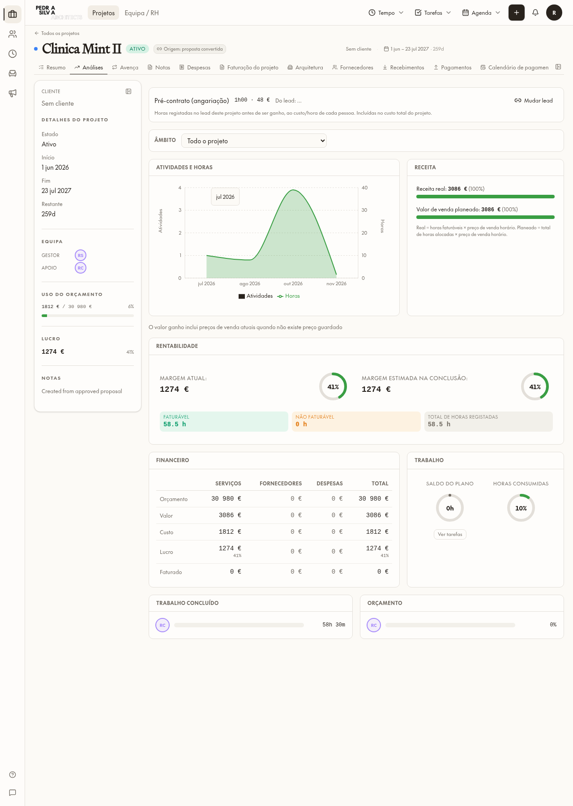
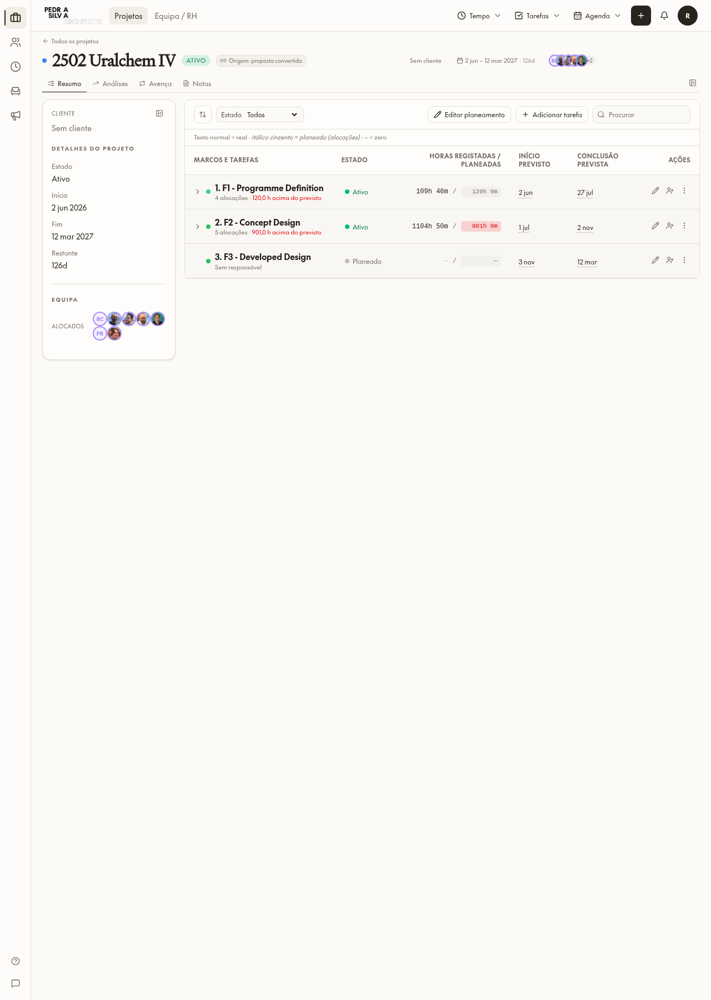
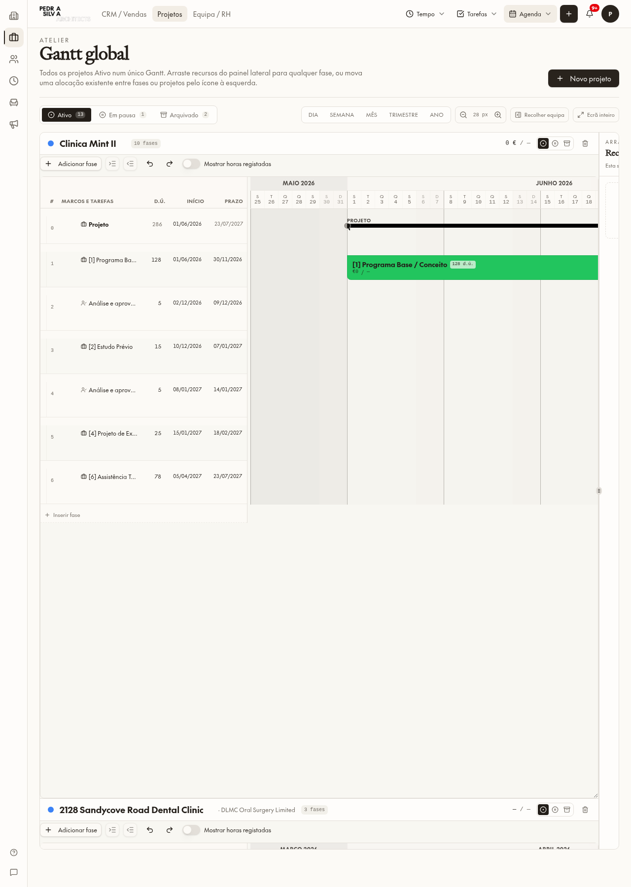
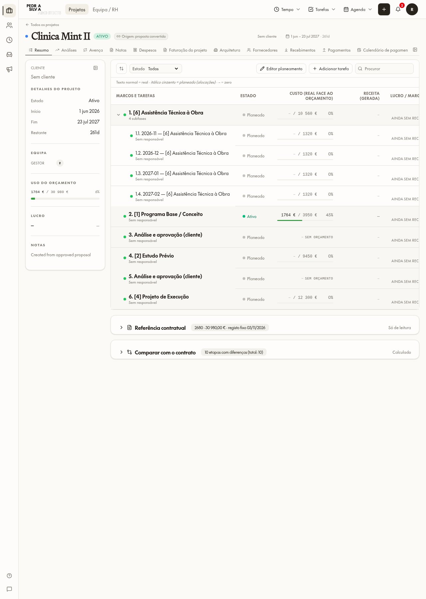
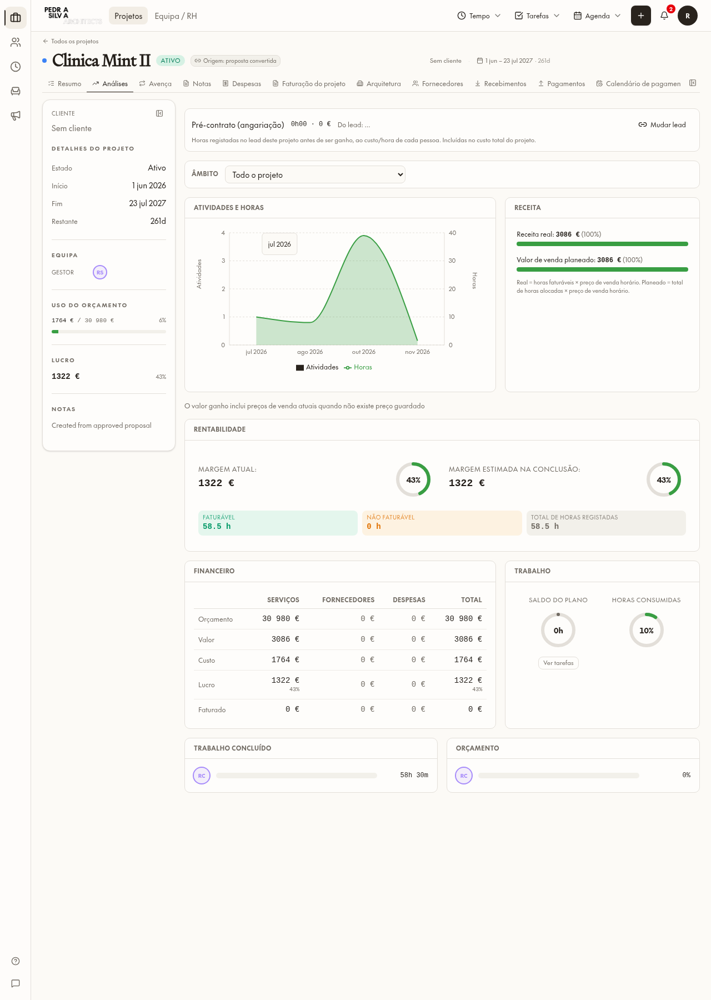
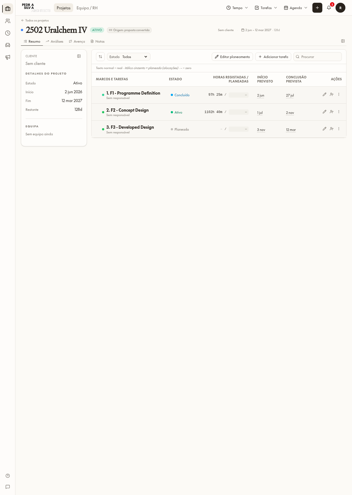
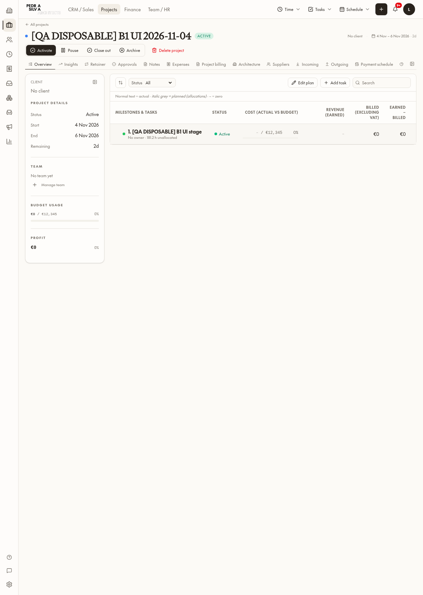
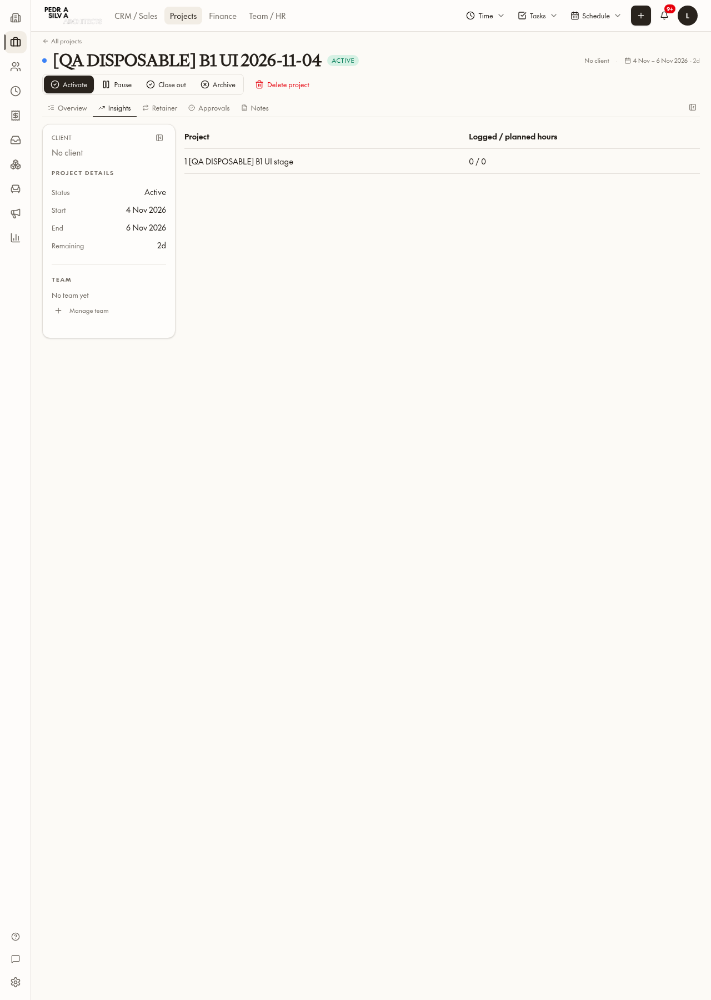

# Fase B1 — plano antes da implementação (4 novembro 2026, 09:22 UTC)

## Corte autorizado — 8 novembro 2026, 15:08 UTC

**PASS — B1 permanece ON, revisão 9. Fase A continua ON. B2 não iniciado.**

### Condição prévia e ação auditada
- Matriz completa comparada por conteúdo, ordenada por pessoa/projeto/área, incluindo IDs e todos os campos de acesso: **1 176 → 1 176, zero diferenças**. SHA-256 de ambas: `13b68e44b0b0c891499603922e82cf7c18ad8dd4801eb3390569b5db1d74e339`.
- A matriz foi lida novamente imediatamente antes da ação e continuava idêntica. Não houve alteração de atribuições ou permissões.
- Uma única ativação por `pm_change_project_b1_cutover`, como Luis: revisão **9**, **2026-11-08 15:14:38.297886 UTC**, motivo exato **`Approved by Luis 2026-11-08`**. A ação validou também o hash da matriz e o estado esperado OFF.
- Rollback pela mesma ação preparado no executor, acionado na primeira falha ou exceção. **Não foi necessário**; não houve segunda ativação.

### Checks autenticados com o gate realmente ON
Cada uma das 11 páginas confirmou `{recorded:true, preview:false, effective:true}`. Não se enviou marcador nem se simulou resposta. Usou-se `scripts/b1-cutover/cutover_checks.py`: espera pelo sinal de totais completos, ausência de placeholders nos totais autorizados e zero pedidos de dados em curso durante a janela de rede inativa; nenhuma pausa fixa para ler números.

| Sessão / página | Resultado observado |
|---|---|
| Rita — Mint Resumo e Análises | **PASS:** receita **3 086 €**, custo **1 812 €**, lucro **1 274 €**, **41%**. Orçamento 30 980 €. Angariação 48 € incluída no custo. |
| Rita — Uralchem Resumo | **PASS:** fases, horas e datas presentes; nenhum valor monetário, nem zeros financeiros substitutos. |
| Rita — Gantt global | **PASS:** valores autorizados de Mint presentes; sem NaN. |
| Patricia — Mint e Uralchem Resumo | **PASS:** dados operacionais presentes, zero valores monetários; totais financeiros omitidos. |
| Patricia — Gantt global | **PASS:** nenhum valor monetário em todo o texto da página; outline operacional sem coluna financeira. |
| Tatiana — Mint Resumo e Análises | **PASS:** mesmos 3 086 / 1 812 / 1 274 / 41%, cliente e áreas financeiras preservados. |
| Tatiana — Uralchem Resumo | **PASS:** custo 42 583 €, orçamento 421 300 €, lucro 31 938 €, margem 43%, como na verificação anterior. |
| Tatiana — Gantt global | **PASS:** valores financeiros continuam disponíveis, sem NaN. |

Capturas inspecionadas visualmente: Rita Mint Análises, Rita Uralchem Resumo, Patricia Gantt global e Tatiana Mint Resumo. As restantes páginas têm texto, captura e resultado automático guardados. Receita de Mint é validada explicitamente em Análises; no Resumo não existe esse total agregado separado.

### Evidência, limites e estado final
- Evidência: `project-access-phase-b1/cutover-20261108/` — comparação da matriz, pré-leitura, ativação, resultados das 11 páginas, textos e screenshots.
- Leitura independente da auditoria após os checks confirmou **B1 ON/revisão 9**, motivo e hora acima; Fase A preservada.
- Nenhum projeto, proposta, fase, data, montante, equipa, snapshot ou ficheiro de cliente foi alterado. Nenhuma fixture ou conta foi criada. A única escrita de aplicação foi a transição auditada B1 autorizada; sessões temporárias autenticadas apenas para os checks.
- Sem alterações de aplicação ou migrações nesta tarefa. Ficheiros atualizados: este relatório, evidências e `roadmap.md`.
- Continuam fora deste corte, sem correção: nome do cliente ausente para Rita pela regra CRM/Finance e orçamento 36 260 € no Gantt global de Mint por soma dos meses da avença, já documentados. Não são novos desvios de B1.
- Limite da comparação de Tatiana no Gantt: a disponibilidade financeira passou; não se declara igualdade integral do texto global com a captura antiga nem com Luis. A contagem monetária é 199 na captura atual, 178 na antiga e 161 no controlo atual de Luis, com diferenças de linhas de colaboradores/alocações. Estes controlos estão guardados em `tatiana-global-parity.json` e `luis-global-gantt-control.*`; não constituem um teste de igualdade por fase. Os totais de Mint/Uralchem de Tatiana coincidem exatamente com as provas anteriores.
- Paragem cumprida; aguardar Luis, **sem B2**.


## Verificações finais antes do corte — 8 novembro 2026, 12:22–12:45 UTC (sem corte)
**B1 OFF (revisão 8, inalterada); Fase A ON. Nenhum dado real alterado; sem fixtures. B2 não iniciado.**

### 1. Marcador de pré-visualização (`x-psa-b1-preview`)
Código que o lê:
- Base de dados — `pm_project_b1_header_preview()` (migração `0267_project_b1_preview_marker_admin_only.sql`, idêntica em `drizzle/migrations` e `supabase/migrations`):
  ```sql
  RETURN coalesce(h,'')='on' AND auth.uid() IS NOT NULL
     AND public.has_role(auth.uid(),'admin')
     AND current_setting('transaction_read_only')='on';
  ```
  `pm_project_b1_active()` = estado auditado gravado **OU** esta função. Antes (0266) bastava ser PSA staff; agora só administradores, e só em transações só-de-leitura (as leituras da API correm assim; qualquer escrita corre em leitura-escrita, onde o marcador é ignorado mesmo para admin).
- `pm_change_project_b1_cutover` recusa qualquer pedido que traga o marcador (`pm_project_b1_marker_present()`), seja quem for.
- Servidor da aplicação — `src/lib/projects/b1-preview.server.ts` (`withB1PreviewHeader`): só reencaminha o marcador depois de confirmar `has_role(admin)` do próprio chamador; regra pura em `src/lib/projects/b1-preview-marker.ts`. Em `default-rates.functions.ts`, o pedido `b1Projection` vindo do navegador também deixou de poder ativar o caminho ON por projeto com o gate OFF.

Testes:
- `scripts/test-b1-preview-marker.sql` (transação sempre revertida): **`B1_MARKER_PASS`, 10 verificações** — Rita, Patricia e Tatiana com marcador em Mint e Uralchem obtêm gate OFF e resultado **idêntico** ao pedido sem marcador (projetos, fases, entradas, recursos, custo bloqueado, angariação); marcador de admin ignorado numa transação de escrita; ação de corte recusa o marcador; controlo positivo: Luis em leitura → pré-visualização ativa.
- `scripts/test-b1-preview-marker.test.ts` — não-admin com marcador não é reencaminhado (3 testes). Com os restantes testes B1: 18 passaram.
- Navegador, depois da 0267 (`final-checks-20261108/after-admin-only-marker/`): Rita, Patricia, Tatiana a enviar o marcador → `effective: false` em todas as páginas; Luis → `effective: true`, Mint 1 812 / 30 980 / 1 274 / 41%, receita 3 086.

### 2. «custo 48 € de 30 980 €»
É o cartão **Uso do orçamento** (custo real / orçamento). 30 980 € = soma dos orçamentos das fases de Mint (5 fases regulares 25 700 € + fase-mãe da avença 5 280 €; os 4 meses da avença não são somados para não contar duas vezes) = honorário contratado (`sold_fee`, baseline contratual 30 980 €). Rita tem Budget e Financials ON em Mint, por isso **deve vê-lo** (Luis e Tatiana veem o mesmo). Errado era só o custo: 48 € era a angariação, a única parcela carregada aos 5 s; o valor final é 1 812 €. A página já mostra «—» até todas as parcelas chegarem.
Observado, não alterado: no Gantt global o orçamento de Mint aparece como **36 260 €** porque esse ecrã soma também os 4 meses da avença (+5 280 €). Acontece igual para Luis e já existia antes de B1; fica para correção separada.

### 3. «Sem cliente» para Rita
Regra de acesso: política de leitura **`Finance or CRM users read companies`** da tabela de empresas — só lê o nome quem é administrador ou tem `finance.dashboard`, `crm.dashboard` ou `crm.pipeline` (mais a restrição `psa_staff_or_own_suppliers`). Rita não tem nenhuma destas permissões, por isso o nome SMILEPROVIDER, LDA não lhe chega e o cabeçalho mostra «Sem cliente». Patricia (`crm.pipeline`) e Tatiana (`crm.pipeline`, `finance.dashboard`) veem o nome. Não depende de B1 nem dos switches do projeto. Não alterado.

### 4. Scripts de verificação sem esperas fixas
`scripts/b1-cutover/cutover_checks.py` só lê valores quando: (1) a página indica `data-totals-ready="true"` (novo sinal no projeto e no Gantt global: todas as fontes dos totais carregadas e nenhuma consulta a decorrer); (2) rede inativa — zero pedidos de dados em curso durante 1,5 s, medido por eventos; (3) para quem deve ver valores, nenhum «—» nos totais. Sem pausas fixas; um limite de 180 s só serve para dar FAIL a uma página que nunca estabiliza. Comparação independente do formato numérico (PT/EN).

Resultados em modo pré-visualização (`final-checks-20261108/preview-staff-marker/`, corrido antes de restringir o marcador a admins, para exercitar o caminho ON destas pessoas):
| Pessoa / página | Estado | Estável em | Valores |
|---|---|---|---|
| Rita — Mint resumo | PASS | 12,5 s | 1 812 € / 30 980 €, lucro 1 274 €, 41% |
| Rita — Mint análises | PASS | 14,6 s | receita 3 086 €, margem 1 274 € / 41% |
| Rita — Uralchem | PASS | 9,8 s | sem valores (0 €), fases/horas presentes |
| Rita — Gantt global | PASS | 33,3 s | só Mint com valores |
| Patricia — Mint / Uralchem / Gantt global | PASS | 11,1 / 10,5 / 43,8 s | nenhum valor monetário |
| Tatiana — Mint resumo / análises | PASS | 11,0 / 14,3 s | igual a Luis: 1 812 / 30 980 / 1 274 / 41%, receita 3 086 |
| Tatiana — Uralchem / Gantt global | PASS | 11,8 / 23,3 s | valores completos (42 583 € / 421 300 €, lucro 31 938 €, 43%) |
Todas as páginas confirmaram `{recorded:false, preview:true, effective:true}`.

Com o marcador já restrito (`after-admin-only-marker/`) as mesmas sessões recebem o resultado OFF atual. Mostra o que B1 corrige: com OFF, Patricia vê hoje 26 valores no Gantt global (orçamentos por fase), e Rita não consegue completar os totais de Mint (ficam «—»).

### Recomendação: **GO**
- Matriz não reverificada nesta tarefa; repetir a comparação ordenada imediatamente antes do corte.
- No corte, os checks live passam a correr só com o gate gravado ON (a pré-visualização já não serve para não-admins): `python3 scripts/b1-cutover/cutover_checks.py --sessions <pasta temporária> --out <pasta>` (sem `--preview`), rollback a qualquer FAIL.
- Pontos fora de B1 a decidir à parte: nome do cliente para Rita (permissão CRM/Finance) e orçamento 36 260 € no Gantt global.

## Pré-visualização igual ao corte ON e teste de paridade — 8 novembro 2026 (sem corte)
**B1 OFF (revisão 8, inalterada); Fase A ON. Nenhuma tentativa de corte, nenhum dado real alterado. B2 não iniciado.**

### O que Rita viu em Mint
| Fonte | Custo / orçamento | Lucro | Margem | Equipa | Linhas de fases |
|---|---|---|---|---|---|
| Corte real ON, revisão 7 (17:29 UTC 6 nov), captura aos 5 s | **48 € / 30 980 €** | **-48 €** | **—** | «Sem equipa ainda» | só o cabeçalho, nenhuma linha |
| Pré-visualização antiga (4–6 nov) | 1 812 € / 30 980 € | 1 274 € | 41% | RS / RC | carregadas |
| Pré-visualização nova = caminho ON, página estável (8 nov) | **1 812 € / 30 980 €** | **1 274 €** | **41%** | RS / RC | carregadas; fase [1]: 1 764 € / 3 950 €, receita 3 086 €, lucro 1 322 € |
| Luis, acesso atual (8 nov) | €1,812 / €30,980 | €1,274 | 41% | RS / RC | iguais |

### Porque divergiam
1. **A pré-visualização antiga não usava o caminho ON.** No navegador de teste, intercetava `pm_project_b1_active` para devolver `true` e redirecionava custos/preços para ações de revisão próprias (`pm_b1_review_stage_locked_cost`, `pm_b1_preview_own`). O servidor continuava a ver o gate OFF. Nos pedidos ao servidor (preços HR) o estado era outro.
2. **Os 48 € no corte real eram um ecrã a meio do carregamento, apresentado como número final.** Antes de chegarem horas/custos das fases, a página tratava a ausência como zero: custo das fases 0 + angariação 48 € (o primeiro valor a chegar) = 48 €, lucro -48 €, receita 0 → margem «—». A equipa e as linhas de fases também ainda não tinham carregado. O teste esperou um tempo fixo de 5 s; com o caminho ON real a página só estabiliza ao fim de **cerca de 10–24 s** no servidor de desenvolvimento. Não houve receita nem custo errados vindos da base de dados: o teste em transação abaixo mostra que Rita recebe exatamente os mesmos dados que Luis.

### Correções
- **Pré-visualização = mesmo código do ON.** Migração 0266 (espelhada em `drizzle/migrations` e `supabase/migrations`): `pm_project_b1_active()` = estado auditado **ou** pedido do próprio utilizador com o marcador `x-psa-b1-preview: on` (só PSA staff). Todos os leitores (`pm_b1_*`, preços no servidor, cliente) passam pelo mesmo ramo ON; não há leitores de revisão. O estado gravado separa-se em `pm_project_b1_recorded_active()`; `pm_project_b1_preview` e `pm_change_project_b1_cutover` leem só o estado gravado e recusam pedidos com marcador. Nada é escrito, nenhuma outra sessão é afetada.
- O cálculo de preços no servidor (`default-rates.functions.ts`) reencaminha o marcador do próprio pedido (`b1-preview.server.ts`) e o filtro por áreas está em `applyB1RateAccess`.
- **Sem números parciais durante o carregamento.** Totais e fases da página usam `src/lib/projects/project-actual-totals.ts` (o mesmo usado pelo teste): até horas, custos, histórico, entradas e angariação estarem carregados, os valores ficam indisponíveis («—»), nunca 48 € / -48 €.

### Testes automáticos
- `scripts/test-b1-gate-on-parity.sql` — **uma transação sempre revertida** (termina com `RAISE`), com o gate gravado substituído por `SELECT true` apenas dentro dela: sem linha de auditoria, sem consumir revisão. Como Luis, Rita e Patricia (`SET LOCAL ROLE authenticated`) chama todos os leitores ON da página e do Gantt global. Resultado: **`B1_PARITY_PASS`, 21 verificações** — Rita = Luis linha a linha em Mint em projetos, fases, 12 entradas, 16 recursos, histórico, horas, custo bloqueado (1 763,775 €) e angariação (47,99 €); Rita com as quatro áreas ON; Patricia sem nenhum número financeiro em Mint/Uralchem (projeto, fases, entradas, recursos, custo bloqueado, angariação, histórico) nem nos 17 projetos do Gantt global. Depois: gate gravado OFF, definição original confirmada.
- `scripts/test-b1-gate-on-parity.test.ts` — com esses dados, passa pelo cálculo da página: Rita = Luis = receita 3 085,875 / custo 1 811,765 / lucro 1 274,11 / **41%**; durante o carregamento → «—»; Patricia → indisponível, nunca zero. 25 testes B1 passaram; build OK.
- Limite: os preços de venda vêm do cálculo HR no servidor e não podem correr dentro da transação SQL; o teste cobre a regra de acesso (`applyB1RateAccess`) e a pré-visualização no navegador confirma o valor real (3 086 €).

### Verificação no navegador (pré-visualização = caminho ON, gate OFF)
Capturas em `project-access-phase-b1/preview-parity-20261108/`: Rita Mint Resumo/Análises 1 812 / 1 274 / 41% (Análises: receita real 3 086 €); Rita Uralchem sem «€» (horas e fases presentes); Patricia Mint, Uralchem e Gantt global sem «€»; Gantt global de Mint igual para Rita e Luis (0 € / 36 260 €; não há alocações planeadas, por isso o custo planeado é um zero real e autorizado).
- Observado, não alterado: o cabeçalho de Rita mostra «Sem cliente» e o de Luis «SMILEPROVIDER, LDA». Já acontecia antes de B1 (leitura da empresa), não é um valor financeiro.

### «Added dark mode toggle»
É o título automático de uma junção de versões (6 nov 11:33). O conteúdo é idêntico à versão anterior com as correções pré-B1 (detalhes do projeto, ações de estado, aviso da equipa, angariação no Budget, traduções). **Não contém nenhum interruptor de modo escuro**; a app não tem esse controlo. As cores para modo escuro já existiam na base do projeto. Nada a remover.

## Gantt global: correção e tentativa única — 6 novembro 17:06 UTC
**Resultado final: B1 OFF/revisão 8; Fase A ON. A tentativa foi interrompida no primeiro check e não foi repetida. B2 não iniciado.**

### Correção
- A falha anterior estava comprovada na captura de Patricia (`0 € / —` e `€0 / —`). Cabeçalhos financeiros globais agora exigem Financials + Budget autorizados no projeto, incluindo estado de acesso carregado; sem autorização são omitidos. Fases sem alocações não fabricam zero quando o custo está negado.
- Barras, indicadores de consumo/excesso, orçamento do outline, popover financeiro, preço/custo de alocação e tooltip de marcos respeitam a decisão financeira do projeto. Os controlos operacionais permanecem disponíveis. Rollups de orçamento preservam ausência em folhas, pais e resumo do projeto; não convertem null/NaN em zero.
- O Gantt atual não tem um total monetário transversal a vários projetos: cada cabeçalho soma apenas fases daquele projeto autorizado. Testou-se também o primitivo de soma autorizada (1000 + 200, excluindo 9999 negados = 1200; todos negados = indisponível), sem acrescentar uma nova barra de totais.
- Ficheiros: `src/routes/_app.projects.gantt.tsx`, `src/components/projects/gantt-chart.tsx`, `src/components/projects/gantt-outline-column.tsx`, `src/lib/projects/build-project-gantt-tree.ts`, novo `src/lib/projects/gantt-financial-visibility.ts`, `scripts/test-gantt-financial-visibility.test.ts`, regra em `src/lib/projects/AGENTS.md`, `roadmap.md` e este relatório. Nenhuma migração/escrita de dados reais.

### Cópia descartável antes do corte
- Um projeto `[QA DISPOSABLE] B1 global Gantt 20261106-1716`, ID `33560505-a08e-4317-8202-b728e0a0a3e9`, uma fase de orçamento 1000 EUR, Rita manager quatro ON e Patricia support quatro OFF. Nenhuma nova identidade, recurso, hora, snapshot ou alocação.
- Sessões autenticadas próprias: projeção proposta lida do servidor com as áreas reais. Para testar a apresentação antes do corte, o navegador mostrou apenas essa cópia e simulou a flag B1 ON; **não se confunde esta revisão com uma certificação live ON**. Rita viu orçamento 1000 e custo genuinamente zero (sem alocações); Patricia não viu moeda, orçamento ou indicadores financeiros. Capturas inspecionadas visualmente.
- Snapshot e referências verificados antes de eliminar apenas a fase/projeto exatos. Leitura independente confirmou projeto=0, fases=0, equipa=0 e acessos=0; não havia alocações/horas antes da eliminação. Auditoria das concessões descartáveis preservada.
- 40 testes passaram na primeira execução (8 novos + 29 scheduling + 3 B1 values), mais 15 no recheck incluindo receita B1. Último estado observado da compilação: OK.

### Tentativa live ON e rollback
- Matriz integral ordenada por `(user_id, project_id, area)`: **1176 linhas, zero diferenças de conteúdo** contra a matriz anterior. Hash SHA-256 `2a8091b4da9164a9b8c2acbdd825dfaad92d54988a1d30b774d0f7b7ec506a41` usa essa ordenação explícita; a mudança do hash em relação ao relatório anterior não é mudança de conteúdo (a igualdade de todos os objetos foi verificada).
- Ação administrativa auditada `pm_change_project_b1_cutover`, motivo `Approved by Luis 2026-11-06`: revisão **7 ON às 17:29:18.739324 UTC**. Nesta etapa não houve interceção/simulação de respostas; Rita confirmou gate real ON.
- **Primeiro check falhou em Rita/Mint Overview:** captura mostrou custo agregado apenas **48 EUR**, lucro **-48 EUR**, receita indisponível e margem `—`, em vez de **3086 /1812 /1274 /41%**; também mostrou equipa/cliente ausentes. Não foi uma repetição da exposição do Gantt a Patricia. A causa imediata observável foi a ausência dos totais de entradas/custos na renderização; não se atribui uma causa técnica definitiva nem se afirma alteração de dados. O executor aguardou cinco segundos; não foi feita outra ativação para investigar.
- **Rollback imediato revisão 8 OFF às 17:29:34.170592 UTC**, confirmado por leitura independente da auditoria. Rita/Uralchem, Patricia, Tatiana e Gantt global live ON não foram concluídos: paragem obrigatória ao primeiro erro. A correção do Gantt está testada na cópia/revisão OFF, mas **a certificação live ON continua pendente**.
- Evidências em `project-access-phase-b1/global-gantt-20261106/`: projeções/capturas descartáveis, snapshot de limpeza, leituras zero, matriz/comparação, captura/texto do primeiro check e transições auditadas. Nada foi escrito em projetos reais; apenas concessões da cópia eliminada e ON/OFF auditados.





## Corte curto autorizado — 6 novembro 2026, pedido 12:58 UTC
**Resultado final: B1 OFF, revisão 6; Fase A ON, revisão 27. Rollback imediato ao primeiro check falhado.**

- Matriz comparada novamente na sessão administrativa, ordenada por pessoa/projeto/área e IDs: **1 176 → 1 176 linhas, zero diferenças de conteúdo**. SHA-256 de ambas: `13b68e44b0b0c891499603922e82cf7c18ad8dd4801eb3390569b5db1d74e339`. Evidência: `cutover-20261106/comparison.json` e `current-sorted.json`.
- Ativação pela ação auditada existente `pm_change_project_b1_cutover`, motivo exato **`Approved by Luis 2026-11-06`**, revisão **5**, às **15:52:55.714070 UTC**. Cada sessão confirmou B1 realmente ON; não houve interceção, simulação ou override de respostas.
- **Rita PASS:** Mint Overview/cabeçalho e Insights mostram receita **3 086 €**, custo **1 812 €**, lucro **1 274 €**, margem **41%**, incluindo o custo de angariação de **48 €** apresentado separadamente e incluído no total. Uralchem mantém fases, horas e datas, sem moeda ou zeros financeiros substitutos em Overview/Insights. Capturas inspecionadas visualmente, além de asserções no texto.
- **Patricia páginas PASS:** Mint e Uralchem, Overview e Insights, quatro áreas OFF, fases/datas/horas disponíveis, nenhum valor monetário.
- **Patricia Gantt global FAIL:** cabeçalho Mint mostra **`0 € / —`** e barras de fases mostram **`€0 / —`** apesar de todas as áreas OFF. A captura confirma uma substituição indevida de custos ocultos por zero; não é prova de que custos reais tenham sido transmitidos. O mesmo padrão aparece em outras fases do Gantt.
- Causa localizada sem alterar código neste pedido: `src/routes/_app.projects.gantt.tsx`, `costsByProject`, inicia custo em zero e só o invalida ao percorrer alocações com preço negado; fases sem alocações deixam esse zero no agregado. `src/lib/projects/build-project-gantt-tree.ts` também transforma budgets ausentes em zero nos rollups (`Number(node.budget ?? 0) || 0`). A superfície ainda renderiza indicadores financeiros globais sem uma decisão de acesso completa por projeto. Estes caminhos precisam preservar indisponibilidade e ocultar os indicadores negados antes de uma nova autorização.
- **Rollback imediato**, revisão **6**, às **15:58:38.704658 UTC**, motivo `Immediate B1 rollback — Patricia global Gantt financial figure visible`. A própria ação retornou OFF e uma leitura independente da auditoria confirmou OFF; Fase A continua ON/revisão 27.
- **Tatiana não testada:** o pedido determina parar ao primeiro check falhado; não se declara preservação live ON de Tatiana nesta tentativa. Não houve repetição ou novo corte após o rollback.
- Nenhum projeto, proposta, fase, data, montante, equipa, acesso ou snapshot real foi escrito; nenhuma fixture foi criada ou eliminada. Apenas as duas transições auditadas B1 foram executadas. Sem migração nem alteração de aplicação. Sessões temporárias foram usadas para Rita e Patricia; nenhuma conta criada. Build observado OK às 15:58:40 UTC.
- Ficheiros alterados: este relatório, evidências em `docs/project-access-phase-b1/cutover-20261106/` e `roadmap.md`. **Paragem cumprida; B2 não iniciado.**





## Receita autorizada — 4 novembro, 22:20 UTC; sem novo corte
**B1 permanece OFF, revisão 4; Fase A permanece ON. Não foi chamada qualquer ação de corte.**

### Origem exata e causa
- Contrato: `pm_projects.sold_fee`/`sold_internal_fee` e `pm_project_contract_baseline.total_fee` são **30 980 €** em Mint; `useProjectDetail` recebe o projeto de `pm_b1_projects`. O orçamento operacional de Overview/cabeçalho é a soma de `pm_stages.budget`, excluindo os filhos `retainer_month`; Insights usa também o baseline imutável para a divisão interna/externa. Estes valores já chegavam a Rita. Não substituir receita gerada pelo preço integral do contrato.
- Receita gerada: Overview e cabeçalho usam `stageActuals` → `useProjectEntryFigures` → `loggedEntryFigures`; Insights recebe exatamente os mesmos totais. As 12 entradas/58,5 horas de Ricardo Cabrita não têm `sale_rate_snapshot`; o fallback normal é o preço efetivo autorizado do autor, **52,75 €/h**, derivado pelo leitor existente de preços. Custo fica nos snapshots históricos, **1 763,775 €**.
- Diferença reproduzida em sessões reais: `pm_b1_resources` devolvia **0 recursos para Rita / 16 para Luis**, mesmo tendo Rita quatro áreas ON em Mint. Enumerava IDs através de `pm_resources_public`, uma vista `security_invoker=on` sujeita ao SELECT legado dos preços. Assim o wrapper autorizado `pm_b1_resource` nem chegava a ser chamado para Rita; faltava o recurso do autor e a receita propagava indisponibilidade. Não era ausência do contrato, divisão por zero nem uma alteração das áreas.
- Correção: `pm_b1_financial_resources` enumera após verificar PSA staff + acesso operacional ao projeto e aplica a mesma redação por áreas a preços de venda/custo. `pm_b1_resources` usa esta projeção para projeto quando B1 está ativo. A revisão explícita usa as mesmas áreas com B1 OFF; `getPmDefaultResourceRates` respeita `b1Projection` também nessa revisão. Sem expor salários, sem fallback cliente privilegiado, sem escrever snapshots/preços/contratos.

### Antes/depois para Rita, antes de qualquer corte
| Projeto / valor | Antes B1 | Depois, revisão autorizada com gate real OFF |
|---|---|---|
| Mint contrato | 30 980 € | 30 980 €, inalterado |
| Mint receita gerada | — | **3 085,875 €** (UI 3 086 €) |
| Mint custo histórico | 1 763,775 € | **1 763,775 €**, inalterado |
| Mint lucro / margem | — / — | **1 322,10 € / 42,8436%** (UI 1 322 € / 43%) |
| Uralchem contrato/receita/custo/lucro | Ocultos na apresentação B1 | **Continuam ocultos**, fases e horas visíveis; nenhum zero financeiro substituto |

Capturas Overview/cabeçalho/Insights usam **revisão isolada no navegador**, não ativação do gate: respostas da projeção própria e preços são lidas do servidor com as áreas reais; flag de apresentação B1 e resumo de custo são adaptados apenas no executor. O resumo de custo da captura é reconciliado com os snapshots legados autorizados de Mint. Portanto estas capturas demonstram o antes/depois pré-corte solicitado, **não certificam o corte live ON**. O antes reproduz a enumeração vazia; o depois usa a nova projeção. Uralchem não monta os cálculos financeiros. O ensaio de extração com B1 OFF não é uma certificação de isolamento dos leitores legados B2.






### Teste descartável e ficheiros
- Um projeto transacional descartável, Rita como manager com quatro switches ON e uma atividade de 8 horas de outro autor; o trigger normal grava o custo. Resultado: contrato **1 000 €**, receita **422 €**, custo **241,20 €**, lucro **180,80 €**, margem **42,8436%**. Cálculo usa as funções reais e a projeção retornada com identidade PM dentro do ensaio protegido administrativo; não é uma sessão browser PM num projeto persistente. Todo o projeto/equipa/acessos/alocação/atividade/horas foi revertido na mesma subtransação.
- Duas primeiras execuções foram recusadas pelos guards normais (horas diretas apenas avença; atividade já criada automaticamente). Ambas transações reverteram integralmente. O teste final reutiliza a atividade automática e passou; nenhum guard foi desativado.
- Zero independente **22:40:08 UTC**: projeto/fase/alocação/atividade/horas/equipa/acessos/auditoria da fixture = **0**; B1 **OFF**, revisão **4**. `zero.json`, `fixture.json`, `fixture-figures.json`, `figures.json` e capturas/textos estão em `project-access-phase-b1/revenue-20261104-2220/`. Nenhuma identidade ou recurso QA foi criado; nenhum projeto real foi escrito.
- **23 testes passam**: all-ON com snapshot de venda ausente, partial, all-OFF e receita zero/ausente mais regressões financeiras; build OK às 22:39:54 UTC. EN/PT não mudou (sem novo texto UI).
- Ficheiros: `src/lib/projects/default-rates.functions.ts`, `scripts/test-b1-revenue.test.ts`, migrações **0260–0263** idênticas em `drizzle/migrations` e `supabase/migrations`, este relatório/evidências e `roadmap.md`. As duas migrações finais ajustam somente o executor descartável; 0260 é a correção produtiva. Tipos regenerados pela plataforma. A nova regra técnica não foi adicionada ao root AGENTS devido ao limite de tamanho; a regra existente de projeções B1 continua aplicável.
- **Paragem:** sem novo corte até aprovação de Luis; B2/B3 não iniciados. A autorização do próximo corte e os checks live ON restantes continuam pendentes, não são substituídos por esta revisão.

## Correção e única nova tentativa — 4 novembro, 18:14 UTC
- **Diagnóstico reproduzido antes da correção:** Rita tem as quatro áreas ON em Mint; lê 12 entradas/58,5 horas, mas o leitor legado `pm_project_stage_locked_cost` devolve zero linhas para ela, enquanto a sessão administrativa recebe quatro linhas mensais e **1 763,775 €** de snapshots. As 12 entradas não têm `sale_rate_snapshot`. A transformação B1 de null em NaN fazia estas ausências parecerem preços negados, impedindo o fallback permitido. Não há prova de uma despesa ou fornecedor real apagado ou alterado.
- Correções: página passa a usar `pm_b1_stage_hours`/`pm_b1_stage_locked_cost` quando B1 está ON, com cache por pessoa/gate; entradas autorizadas recuperam o fallback normal quando falta snapshot (avenças continuam sem estimativas de custo); preços derivados positivos e autorizados podem suprir um campo manual ausente. Margens usam guardas partilhadas de receita/lucro finitos e receita positiva, no sidebar/rail, Insights, tabela e popover Gantt (também global); avenças deixam de apresentar 0% para receita zero. Nenhuma permissão foi alargada nem snapshot escrito.
- **24 testes passaram:** 19 Vitest (finance/B1, incluindo all-ON=40%, cada área parcial, all-OFF, receita zero/ausente, lucro não finito) e cinco testes de custos de avença. Duas tentativas de executor incorreto para o ficheiro Node foram corrigidas; resultado final `bun test` 5/5. Build OK às 18:20:06 UTC.
- **Única nova tentativa realizada**, mesmo motivo auditado `Approved by Luis 2026-11-04`, revisão **3**; matriz novamente comparada integralmente com a aprovada. B1 realmente ON. Overview de Rita/Mint já mostra o custo correto **1 764 €** e já não mostra NaN, mas **receita/lucro continuam «—»**: a correção de apresentação/custo não resolveu integralmente o caminho de valorização da receita. O teste exige lucro numérico para Rita e falhou, antes de continuar para as restantes superfícies.
- **Rollback automático imediato**, revisão **4**, motivo `Immediate B1 rollback — Rita Mint profit missing: LUCRO\n—`; leitura posterior **B1 OFF, Fase A ON**. Não houve segunda repetição neste pedido. Não se afirma que a causa completa ou o corte estejam resolvidos; a receita autorizada ainda necessita diagnóstico/correção, sem inventar preços ou converter ausência em zero.
- Restantes checks de Rita/Uralchem, Patricia/Bernardo, quatro globais, inspetor/Gantt global, attachment e edição operacional foram interrompidos por esta falha. **Nenhuma fixture foi criada**: não houve teste de edição nem limpeza fictícia; dados reais não foram alterados. Evidências em `project-access-phase-b1/retry-20261104-1814/` (captura/texto de Rita Mint e `on-results.json` com ativação/reversão).
- Ficheiros: `src/lib/projects/{financial-calculation,use-project-entry-figures,use-default-rates}.ts`, `src/routes/_app.projects.$projectId.tsx`, `src/components/projects/{gantt-chart,retainer-monitor-panel}.tsx`, `scripts/test-project-financial-calculation.test.ts`, relatório/evidências e `roadmap.md`. Sem migração ou schema change. **Paragem após a tentativa falhada; aguardar Luis, sem B2.**

## Corte autorizado por igualdade de conteúdo — 4 novembro, 17:42 UTC
- **Matrizes iguais:** 1 176 linhas antes/depois, ordenadas por `person, project, area` (IDs como desempate), comparação completa de cada campo e zero diferenças. SHA-256 canónico de ambas: **`13b68e44b0b0c891499603922e82cf7c18ad8dd4801eb3390569b5db1d74e339`**. Excluídas apenas as três anotações editoriais do relatório (`b1_before`, `b1_after`, `activation`), inexistentes na matriz original; todos os campos da matriz foram comparados.
- Ativação pela ação administrativa existente `pm_change_project_b1_cutover`, motivo exato **`Approved by Luis 2026-11-04`**, revisão **1**. O hash legado requerido pela ação foi lido novamente, sem alterar o mecanismo nem as permissões. Leituras autenticadas confirmaram **B1 realmente ON e Fase A ON**, sem simulação.
- Foram percorridas 42 páginas reais (7 sessões × Mint/Uralchem × Overview/Insights/avença), com capturas e textos. Rita Mint e quatro globais mantiveram budgets projetados; Rita Uralchem, Patricia e Bernardo conservaram fases operacionais com budgets/custos nulos e sem moeda nas páginas verificadas. **Estes checks automáticos não constituem aprovação final:** a inspeção visual seguinte identificou a falha abaixo, não detetada pelo primeiro conjunto de asserções.
- **Falha real:** Overview de Mint para Rita mostra **`NaN%` no lucro**, em vez de indisponibilidade corretamente apresentada. O mesmo artefacto aparece em capturas/textos de Irene e Ricardo. A origem está no cálculo de `profitPct` e na condição de apresentação que aceita um número não finito. Não foi alterado código neste pedido, porque a instrução determina rollback e relatório ao primeiro check falhado.
- **Rollback imediato após identificação visual**, pela mesma ação auditada, revisão **2**; motivo `Immediate B1 rollback — live Mint Overview renders NaN% in profit; unavailable actuals are not safely formatted`. Leitura autenticada posterior: **B1 OFF, Fase A ON**. `rollback.json` é o estado final, prevalecendo sobre o checkpoint ON guardado em `on-results.json`.
- Inspetor, Gantt global, attachment allow/deny e edição operacional descartável **não concluídos**: interrompidos pela falha real. Nenhuma fixture foi criada neste pedido; zero por nome exato confirmado. Não houve alterações em projetos, propostas, datas, montantes, equipa ou acessos reais; apenas duas transições auditadas do gate B1. Não se repetiram checks Finance recusados.
- Evidências: `project-access-phase-b1/cutover-20261104-1742/` contém ambas as matrizes ordenadas, `comparison.json`, capturas/textos de páginas reais, checkpoint `on-results.json` e confirmação `rollback.json`. Ficheiros alterados: este relatório, evidências e `roadmap.md`; requisito de comparação independente da ordem atualizado na memória. Nenhuma migração ou alteração de esquema. **Parar e aguardar Luis; B2 não iniciado.**

## Autorização de corte 4 novembro, 17:36 UTC — interrompida antes de ativar
- Leitura autenticada administrativa de `pm_project_b1_preview`: hash atual **`1cf42c8ef49c1f1e67b132dfa5ea185d`**, diferente do hash aprovado **`020f61e7f8cab09c838d2ac25bd4e7bc`**. Conforme instrução de Luis, não foi chamada a ação de ativação.
- Estado lido: **B1 OFF**, **Fase A ON**. Sem rollback necessário: B1 nunca foi ativado neste pedido. Nenhuma escrita de dados reais ou fixture criada.
- Comparação por `(user_id, project_id, area)` com `matrix-before-after.json`: **1 176 → 1 176 linhas; zero linhas adicionadas/removidas; zero alterações em qualquer campo da matriz**. A sequência de linhas difere da cópia guardada. A implementação de `pm_project_access_matrix` usa `jsonb_agg` sem `ORDER BY`, enquanto o hash calcula o texto do array, portanto é sensível à ordem. Isto identifica uma fragilidade do cálculo, não uma alteração comprovada de permissões; não se alterou o cálculo nem se substituiu a aprovação.
- Evidência: `project-access-phase-b1/cutover-20261104-1736/current-matrix.json` e `matrix-diff.json`. Não foram feitos ensaios ON de páginas, inspetores, Gantt ou anexos nem edição descartável: a condição prévia de Luis falhou. A captura de preflight ficou em carregamento e não é usada como prova de resultado visual.
- Paragem solicitada cumprida; aguardar Luis antes de qualquer nova tentativa. B2 não iniciado.

## Plano aprovado para construir, não para ativar
1. Preservar Fase A ON e criar gate B1 independente, inicialmente OFF, com alteração administrativa auditada e aprovação de matriz separada.
2. Adicionar projeções operacionais autorizadas para os leitores B1: projetos/fases/alocações/horas/recursos e evidência da proposta convertida. Dados operacionais permanecem disponíveis; contrato/venda por Financials, custos/snapshots/orçamento por Budget, despesas por Expenses, fornecedores por Suppliers. Não modificar dados históricos ou permissões reais.
3. Migrar Overview/cabeçalho, Insights do projeto, avença, orçamento, inspetores e Gantt; Gantt global e homepage. Valores negados são ausentes/nulos, nunca zeros; margens e agregados integrados exigem todas as parcelas autorizadas. Preservar ações operacionais e impedir que valores ausentes sejam gravados por formulários.
4. Comparar matriz antes/depois e executar verificações read-only dos utilizadores indicados; testar projeções/áreas com um único projeto descartável de cada vez, sem ativar o gate real. Eliminar apenas IDs comprovados e confirmar zero independente.
5. B2: inventariar alcance atual de forecast/Insights globais/relatórios/pesquisa sem Finance ou Reports. B3: completar mapa de documentos/exportações/PDF, sem implementação de ambas.
6. Registar ficheiros, migrações espelhadas, testes/capturas, limitações e gate final OFF. Parar antes da ativação, aguardando Luis.

## Evidência e resultados
### Estado final
- Fase A **ON**; B1 **OFF**, sem qualquer linha em `pm_project_b1_cutover_audit`. Nenhum corte B1 efetuado. A ação administrativa exige estado anterior, motivo e hash atual da matriz.
- Schema e leitores B1 preparados; testes de projeções e apresentação abaixo. **Não se declara isolamento financeiro completo**: leituras legadas B2/B3 continuam acessíveis conforme o inventário. Nenhuma equipa, switch, data, valor ou snapshot real foi alterado.
- Hash de matriz observado: `020f61e7f8cab09c838d2ac25bd4e7bc`. Recalcular antes de futura aprovação; não reutilizar se houver alterações.

### Cobertura B1
| Superfície | Caminho preparado | Regras |
|---|---|---|
| Overview/cabeçalho | `useProjectDetail`, recursos e entradas `pm_b1_*` | Valores ausentes propagam NaN/«—»; lucro/margem integrados exigem Financials + Budget + Expenses + Suppliers |
| Insights do projeto | Painel financeiro existente apenas com todas as áreas; alternativa `B1OperationalInsights` | Operacional para all-OFF; venda e custo em colunas separadas conforme área |
| Avença | Mesmo fallback operacional para permissões parciais; painel completo com todas as áreas | Custos reais só snapshots positivos; consultas diretas do painel completo substituídas por entradas B1 quando ativo; preços globais não consultados |
| Orçamento/actuals | `useStageBudgetControl`, `useProjectEntryFigures`, `useGanttActuals` | Snapshot histórico intacto; ausência não tratada como custo zero; resumo guardado `pm_b1_stage_locked_cost` |
| Inspetor/Gantt | `OperationalScheduleAdapter` + dados do projeto, sem sincronizar proposta | Edição de budget escondida sem Financials; popover de margens e faixa financeira só com todas as parcelas; não calcular horas implícitas a partir de preços globais |
| Gantt global | `useProjects(true)`, `useAllStages({b1Projection:true})`, recursos B1 | Autorização/redação por projeto antes de somar; não há estimativa de custo com área negada |
| Homepage | Revisão de `_app.index.tsx` e `ThisWeekCard` | Já não tem strip financeiro/projetos com valores; mantém `weekBoardQuery` + `personalHomeWeek`, apenas planeamento pessoal aprovado/no-rates. Sem migração desnecessária nem abertura de drafts |
| Comparação contratual | `useLivePlanForDiff` passa fases pela projeção | Pagamentos continuam protegidos pela Fase A; documento contratual e restantes exportações pertencem ao mapa B3 |

Campos mistos importados `rate`, `profit`, `content`, `raw`, `subject` e referência fiscal foram incluídos na redação: texto/raw não pode reconstruir parcelas negadas. Cache dos leitores B1 inclui chamador e estado do gate; áreas são refrescadas periodicamente. A eliminação final de SELECTs amplos fica dependente de migrar B2/B3: revogá-los agora quebraria essas superfícies.

### Matriz efetiva antes/depois e sessões reais (somente leitura)
`effective-before-after.csv/json` contém **14 comparações reais** (7 pessoas × Mint/Uralchem), com contagem de linhas operacionais e budgets presentes, além das quatro áreas. A matriz administrativa completa de **1 176 linhas** está em `matrix-before-after.csv/json`; o seu campo “before” é uma classificação de caminho legado, **não medição de valores**. Para valores efetivos usar os ficheiros `effective-*`.

| Pessoa | Mint: fases / budgets legados → projetados | Uralchem: fases / budgets legados → projetados | Áreas propostas |
|---|---|---|---|
| Rita | 10 / 10 → 10 | 3 / 3 → 0 | Mint quatro ON; Uralchem quatro OFF |
| Patricia | 10 / 10 → 0 | 3 / 3 → 0 | Quatro OFF |
| Bernardo | 10 / 10 → 0 | 3 / 3 → 0 | Quatro OFF |
| Luis | 10 / 10 → 10 | 3 / 3 → 3 | Quatro ON |
| Tatiana | 10 / 10 → 10 | 3 / 3 → 3 | Quatro ON |
| Irene | 10 / 10 → 10 | 3 / 3 → 3 | Quatro ON |
| Ricardo Conceição | 10 / 10 → 10 | 3 / 3 → 3 | Quatro ON |

Os zeros desta tabela são **contagem de campos presentes**, não valores financeiros. As fases operacionais não desapareceram. Sessões reais leem `pm_b1_preview_own` sem ativar B1; capturas de páginas reais foram feitas com B1 OFF. Não confundir estas capturas com uma verificação do corte ON.

### Testes descartáveis, capturas e zero
- Uma fixture transacional de cada vez: seis combinações (all-OFF, cada área isolada, all-ON), **36 asserções** sobre venda/custo/notas/fornecedor/datas. `pm_validate_b1_fixture` é admin-only; subtransação sempre revertida, sem ativar gate. Últimos IDs: projeto `729648cc-fb22-4155-9682-2a3cec4c2bcf`, fase `a9d4ca6d-a992-45d3-8dde-4ca1b5dd9be4`.
- Apresentação all-OFF numa cópia criada/eliminada sequencialmente: página autenticada com resposta do gate/áreas simulada **apenas no navegador de teste**, não no servidor. A captura final mostra apenas fase e horas; nenhum budget, custo ou lucro. Isto valida apresentação, não substitui um ensaio real ON.
- Última cópia UI `427aaf31-5591-40f2-83a1-688c6e732d36`; tentativas anteriores também eliminadas. Consulta independente por nomes exatos das fixtures e IDs: **projetos=0, fases=0, equipa=0, acessos=0, ações gate B1=0 às 10:28:24.809 UTC, 4 novembro 2026**. Nenhum documento/anexo/identidade/recurso foi criado nestes testes.
- 35 testes Vitest + 23 testes Node de actuals passaram (**58**); paridade EN/PT e AST passaram (zero novos literais). Build OK às 10:28:08 UTC. A primeira execução do teste Node por Vitest falhou por executor errado, depois passou no executor correto.
- Primeira captura isolada ficou vazia por falta dos providers do executor; descartada/substituída pela captura da página autenticada. Um seletor esperado como “Project summary” foi corrigido para o rótulo existente “Project”; a imagem confirmou o painel não vazio.




Capturas read-only de Rita, Patricia, Bernardo e quatro globais e resultados em `project-access-phase-b1/`. `final-gates.json` e `fixture-validation.json` registam gate e teste. Não foram repetidos checks Finance anteriormente recusados nem tocada a fatura Mint de 6 000 €.

### B2 — alcance atual sem Finance/Reports (inventário, sem implementação)
| Superfície | Rita/Patricia no navegador | Fonte/guarda atual | Exposição a rever em B2 |
|---|---|---|---|
| `/projects/forecast` | Abre | Módulo Projects; leitores legados | Dados/totais financeiros não exigem entrada Finance; abertura confirmada, não equivalência de cada total |
| `/projects/insights` | Abre | Projects; hooks de stages/resources/Insights legados | Totais globais precisam redação antes de agregar; zeros vistos na página não provam ausência de exposição |
| `/projects/financials` | Abre | É Projects, não Finance | Finance module não é pré-requisito; manter identificado, sem implementar B2 |
| `/reports/business`, `/reports/budget` | “Acesso restrito” | `V2PermissionGate reports.view/all` | Negação UI confirmada nestas duas; RPCs/hooks diretos ainda precisam ensaio de política por chamador |
| Reports hours/health/estimates/capacity/billable | Não testados live | Mesma guarda Reports encontrada no código | Inventário de fonte; não afirmar negação end-to-end de todos |
| Pesquisa timesheet | Disponível no fluxo Projects/Time; não ensaiada neste turno | `useProjectSearch` em `use-timesheet.ts`, cliente/RLS | SELECT projeto/fases, sem requisito Finance/Reports no hook; verificar que só campos operacionais chegam ao resultado |
| Listas/pesquisa projeto e cliente | Caminhos existentes | `useProjects`/stages legados por defeito | Continuam fora B1; filtros/listas/totais precisam migração deliberada B2 |
| MCP list-projects/list-companies | Não testado live | Ferramentas em `src/lib/mcp/tools` | Autorização de registo/resultados a confirmar; não classificar como seguro sem ensaio |

Evidência navegador: `b2-rita.json`, `b2-patricia.json` e capturas correspondentes. Acesso ao módulo Finance não é equivalente à capacidade global por projeto; não se retirou nenhum acesso real.

### B3 — mapa documentos/exportações/PDFs (sem build)
| Origem → chamador | Guardas atuais / dados | Trabalho de B3 |
|---|---|---|
| `gantt-print-button.tsx` → planner | `window.print`; conteúdo já renderizado, sem reautorização de todas as áreas | Confirmar cada ponto de montagem e impressão apenas de parcelas permitidas |
| `composer-top-bar.tsx` → Composer | PDF e Word copiam documento no navegador; acesso do editor/proposta | Documento pode incluir várias áreas; guardá-lo inteiro ou saída autorizada, sem reescrever história/idioma |
| `versions-panel.tsx` → `getRevisionPdfUrl` em `use-proposal-revisions.ts` | URL assinada em `proposal-pdfs`, cliente/RLS | Rever vínculo projeto/áreas e validade dos URLs já emitidos |
| `signature.functions.ts` → envio de revisão | Sessão + snapshot/proposta do chamador; download privilegiado após vínculo | Reautorizar todas as áreas do documento antes de envio/download; não alterar hashes/evidência |
| `use-download-invoice-pdf.ts` | `pm_invoice_items`, projeto, faturas relacionadas; cliente/RLS; chamador UI não localizado | Confirmar se está montado; testar guarda Financials + isolamento de relacionadas |
| `project-attachment.ts` → `project-billing-tab.tsx` | Download Storage pelo próprio utilizador, proteção Fase A | Preservar allow/deny já existente; rever caminhos alternativos/signed URLs |
| `use-documents.ts` → listas/editor/settlements/purchases/invoices | `financial_documents`, linhas/pagamentos/fila; RLS por entidade | Auditar todos os chamadores, entidade e pesquisa; não apenas visibilidade da lista |
| `issued-pdf.functions.ts` → issued-pdf upload/review | Sessão, escrita Finance, entidade/projeto/Financials e fila/path | Preservar ação de confirmação e vínculo issued-PDF; revalidar extração/saída |
| Finance receipt/intake | Guards Expenses e entidade nas funções existentes | Rever recibo que contém várias despesas/alocações e fronteira de saída |
| `contabilidade-export.server.ts` → Drive-intake/job | Exportação server; callback/job privado existente | Verificar autenticação do job, filtro entidade/projeto e artefacto gerado; não ensaiado |
| `backup.functions.ts` → administração | `assertAdmin` em todas as operações inspecionadas; backups completos | Rever seleção run/tabela/Storage e pesquisa; sem ampliar autorização |

Mapa concluído dos caminhos localizados no código; **não é certificação exaustiva de todos os links assinados ou políticas**. Chamador da antiga fatura PDF, MCP e ensaios diretos de jobs permanecem tarefas de verificação B3, não alterações desta entrega.

### Ficheiros e migrações
- Migrações **0255–0259**, espelhos idênticos em `drizzle/migrations` e `supabase/migrations`: gate/auditoria/projeções; helper de revisão retirado e revogado; preview read-only próprio; teste descartável revertido; redação de campos mistos e resumos guardados. Tipos regenerados automaticamente.
- `src/lib/projects/`: `b1-projection.ts`, `use-project-access.ts`, `use-planner.ts`, `use-default-rates.ts`, `default-rates.functions.ts`, `use-project-entry-figures.ts`, `use-gantt-actuals.ts`, `use-historical-time.ts`, `use-stage-budget-control.ts`, `use-live-plan-for-diff.ts`, `project-area-tabs.ts`, `AGENTS.md`.
- `src/components/projects/`: `b1-operational-insights.tsx`, `project-planner-inspector.tsx`, `gantt-chart.tsx`, `retainer-monitor-panel.tsx`; `src/components/planner/planner-gantt.tsx`.
- `src/routes/_app.projects.$projectId.tsx`, `src/routes/_app.projects.gantt.tsx`; homepage inspecionada/preservada (no-rates, nenhuma alteração necessária).
- `src/lib/quotes/use-team-pricing-averages.ts`, `use-resource-pricing.ts`: opção enabled para não consultar preços globais no contexto B1; cálculos/documentos de propostas inalterados.
- `scripts/test-project-b1-values.test.ts`, este relatório/evidências e `roadmap.md`.

### Limites para a futura aprovação
B1 continua OFF. Não foi ensaiado um corte real ON, nem todos os painéis financeiros completos em cada sessão sob ON; as leituras projetadas foram verificadas na sessão real, a apresentação all-OFF apenas na cópia com simulação local. B2/B3 não implementados. Antes de autorizar ON, rever a matriz atual e realizar o ensaio de corte separado; não usar a presente entrega para afirmar isolamento completo dos leitores legados.