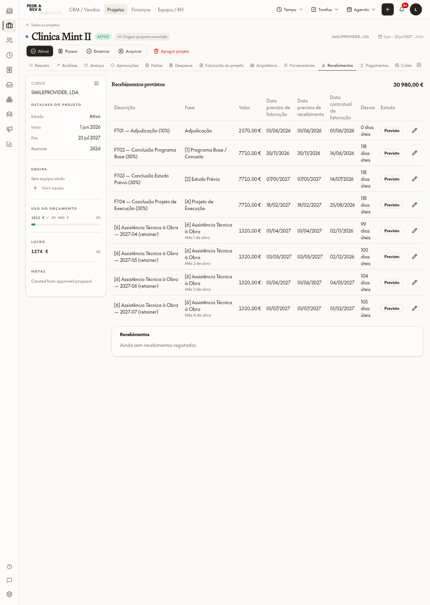
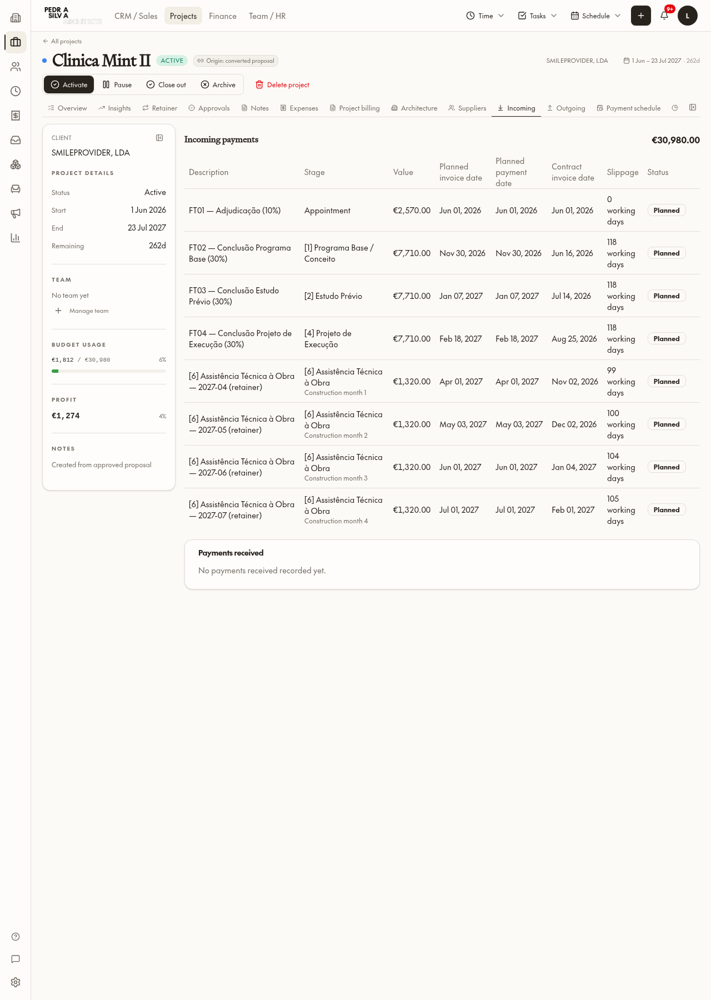

# Item 2 — Datas operacionais de recebimentos

3 novembro 2026. Lovable Cloud recuperado após Tiny → Small. Limpeza antiga concluída antes de construir; sem alterações de linhas reais da Mint, propostas, contrato, montantes, IVA, termos ou `pm_convert_relative_quote`.

## Implementação
- Entrada do projeto lê a projeção protegida `pm_project_incoming_timing`, não o plano relativo da proposta. Datas calculadas na leitura: fase operacional atual, adjudicação com evidência ou data fixa; avenças no primeiro dia útil do mês + ordinal aceite.
- Precedência: congelamento → override → marco. Desvio em dias úteis e dias de calendário, contrato e recebimento devolvidos pela mesma função. `payment_offset_days` aplicado uma vez; não interpretar texto dos termos.
- Contrato associado por snapshot aceite + ID da prestação/fase e correspondência única de rótulo, valor, tipo, posição e nome da fase. Sem correspondência comprovada: Por definir e causa. Não preencher colunas reais por backfill.
- A projeção pública é SECURITY DEFINER, **não invoker como proposto inicialmente**, com autorização explícita por projeto antes da leitura e resolver interno sem EXECUTE para clientes. Motivo: gestor sem Finance deve receber esta projeção sem abrir SELECT monetário geral.
- Ações de datas só aceitam campos de data, marco e fase do próprio projeto; motivo obrigatório e auditoria. Identidade do gestor por recurso único e `pm_project_team.role=manager`. Finance autorizado ou gestor; Fase A preparada para exigir Financial ON quando o corte for aprovado.
- Congelamento na primeira transição issued/paid e vínculo a linha de documento emitido; locks por linha. Overrides e datas diretas de entradas exigem a ação auditada. Histórico issued/paid conserva expected dates; não reconstrói valores pelo Gantt atual.

## Mint — leitura real, oito prestações
Total líquido **30 980 €**. Datas ISO abaixo; todas as linhas têm ligação operacional/contratual única no resolver. Estado atual de todas: planned. Datas de contrato permanecem distintas das fases atuais.

| Prestação | Fase operacional | Faturação prevista | Recebimento previsto | Faturação contratual | Recebimento contratual | Desvio útil |
|---|---|---|---|---|---|---|
| FT01 | Adjudicação | 2026-06-01 | 2026-06-01 | 2026-06-01 | 2026-06-01 | 0 |
| FT02 | [1] Programa Base / Conceito | 2026-11-30 | 2026-11-30 | 2026-06-16 | 2026-06-16 | 118 |
| FT03 | [2] Estudo Prévio | 2027-01-07 | 2027-01-07 | 2026-07-14 | 2026-07-14 | 118 |
| FT04 | [4] Projeto de Execução | 2027-02-18 | 2027-02-18 | 2026-08-25 | 2026-08-25 | 118 |
| FT05 | [6] Assistência Técnica à Obra | 2027-04-01 | 2027-04-01 | 2026-11-02 | 2026-11-02 | 99 |
| FT06 | [6] Assistência Técnica à Obra | 2027-05-03 | 2027-05-03 | 2026-12-02 | 2026-12-02 | 100 |
| FT07 | [6] Assistência Técnica à Obra | 2027-06-01 | 2027-06-01 | 2027-01-04 | 2027-01-04 | 104 |
| FT08 | [6] Assistência Técnica à Obra | 2027-07-01 | 2027-07-01 | 2027-02-01 | 2027-02-01 | 105 |

**Condições versus offset:** FT02–04 têm texto “30 dias de calendário”, mas `payment_offset_days=0`, tal como as outras linhas. Por isso previsão de recebimento coincide com faturação. Nenhum termo/offset foi corrigido silenciosamente; esta divergência requer decisão comercial separada.

## Verificação e limites
- Fixture única sem proposta, eliminada no finally: fim 9/6 → 12/6; offset 30 dias; override 15/6 → recebimento 15/7; limpar restaura 12/6; valor 999 negado; 100/23%/30 dias intactos; primeira emissão congela 12/6 apesar de fase passar a 19/6; override congelado negado.
- Transação integralmente anulada com identidade de Bernardo como gestor **só da fixture**: helper permitiu override 15/6, montante permaneceu 100; amount patch e mudança de papel negados; helper negou a Mint. Não alterou conta/permissões reais nem equipa real.
- Nove testes Vitest (3 segurança datas, 4 relativo, 2 isolamento Gantt); parity e AST i18n sem candidatos novos; build OK.
- Capturas PT/EN verificadas com preferência substituída apenas na leitura do navegador; idioma real não foi guardado.
- **Não verificado:** novo caminho completo de conversão → emissão fiscal parcial/concorrente, pagamento parcial por banco, edição UI de override, Undo completo do Gantt. Teste de emissão cobriu billing_status, não todos os caminhos fiscais. Regroup/Finance forecasts antigos continuam com expected dates; projeção pronta para futura integração Finance, não foi construída nova página Finance.
- Fase A está preparada, não ativada. Todas as alterações de permissões efetivas por quatro áreas aguardam matriz.

## Ficheiros
Migrações 0222/0223/0224/0228 e mirrors `supabase/migrations/2026110320{31,32,36,45}00_*.sql`; tipos regenerados. Código: `src/lib/projects/payment-timing.ts`, `use-project-payment-schedule.ts`, `src/components/projects/project-incoming-payments.tsx`, `src/routes/_app.projects.$projectId.tsx`, `use-project-planner-adapter.ts`; traduções projects EN/PT; `scripts/test-project-payment-timing.test.ts`; regras AGENTS e roadmap.

Leitura final 20:40:42 UTC: projetos/propostas/oportunidades/alocações descartáveis **0/0/0/0**; date audit=0 e access assignments/audit=0 (só fixtures foram criadas e apagadas).
