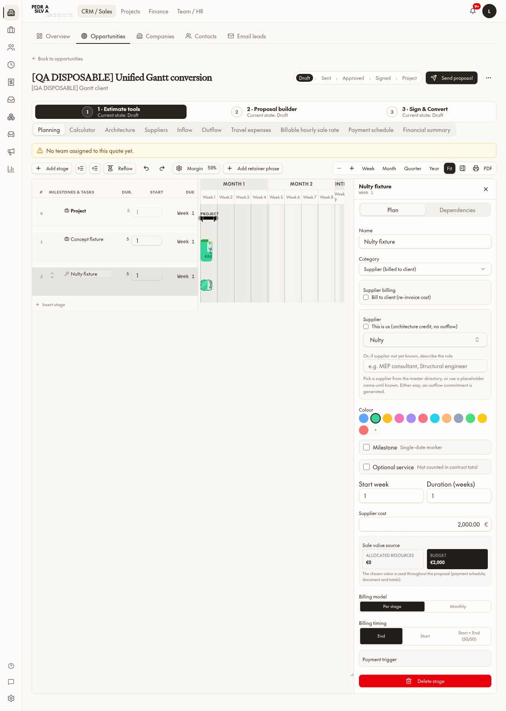
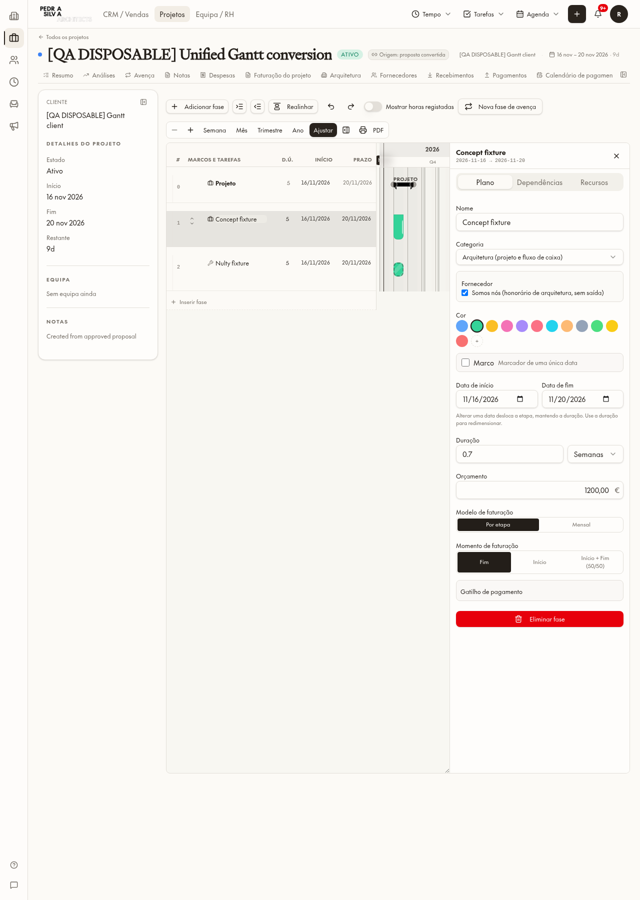
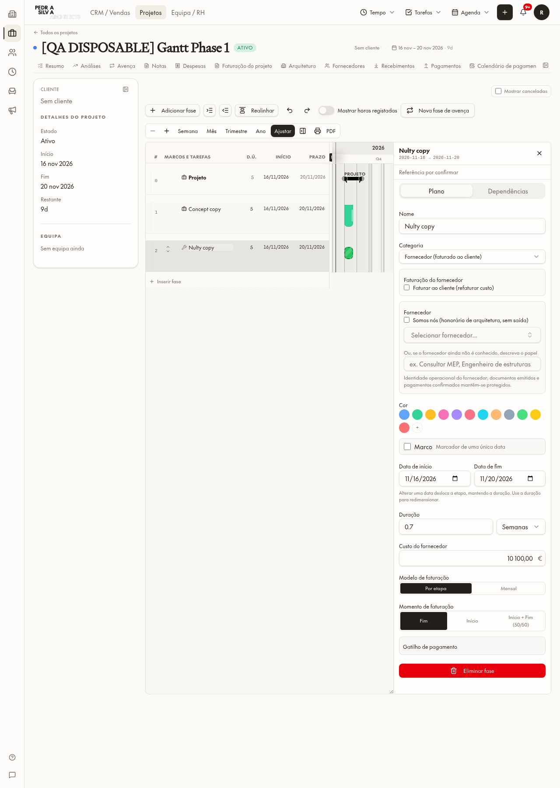
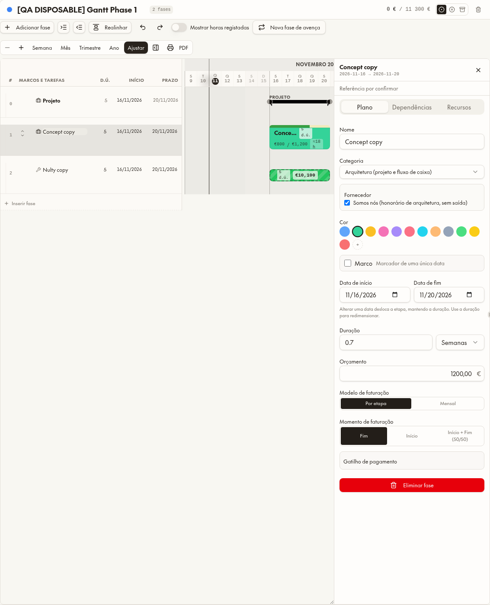

# Gantt partilhado — Fase 1

**Verificação final:** 11 novembro 2026, 13:52 UTC. **Fase 2 não iniciada; aguarda OK de Luis.**

## Resultado

- CRM, projeto direto, projeto convertido e cada projeto da vista global usam `QuoteGantt`, o mesmo `SharedPlannerInspector` e `PlannerToolbar`. Nome, categoria, fornecedor, “Somos nós”, cor, marco, dependências, recursos, valor e modelo/momento de faturação vêm do mesmo painel. Datas relativas no CRM e datas reais no projeto continuam distintas; horas registadas só existem no operacional. Configuração comercial da proposta e dados operacionais continuam com adaptadores diferentes, não com dois painéis concorrentes.
- Nulty é identificado como fornecedor externo pela evidência operacional `is_self=false`; apresenta o ícone de fornecedor e barra hachurada. A cor guardada é preservada. Não foi feito backfill nem copiada a identidade da proposta mutável para Mastercard.
- Novas conversões preservam papel, fornecedor/placeholder e opções operacionais a partir da revisão aceite, por ID de fase. Uma conversão sintética aceite comprovou `supplier_id` e `supplier_phase` no projeto.
- `pm_can_edit_gantt` reutiliza exatamente o acesso Financials existente do projeto, com identidade autenticada e PSA staff. Não há autorização por nome, email ou cargo. A autorização aplica-se ao Gantt, ao batch de planeamento e às escritas diretas de fases/alocações/dependências; antigos grants permissivos não bastam para contornar o guarda.
- Uma referência contratual vazia mostra **Referência por confirmar**. Mastercard conserva a ligação, origem, badge e baseline, sem reconstrução ou alteração de valores reais.

## Ricardo e isolamento da proposta

1. Projeto descartável direto: Ricardo alterou `Concept copy` de **1 000 € para 1 200 €**, recarregou a página e leu **1 200 €**. A mesma fase abriu no painel da vista global.
2. Projeto descartável convertido: Ricardo alterou `Concept fixture` para **1 200 €** e recarregou; a fase da proposta aceite continuou em **1 000 €**. Não houve sincronização de volta à proposta.
3. Conta sem Financials: `pm_can_edit_gantt=false`; UPDATE direto da fase recusado com `Forbidden`.
4. A mesma conta, com um grant Financials auditado apenas no projeto descartável: acesso verdadeiro e gravação de **1 300 €** confirmada. O grant e as linhas da cópia foram eliminados com a cópia.

Os nomes de pessoas foram usados para escolher sessões de teste, não como lógica de autorização.

## Screenshots

### CRM — mesmo painel e fornecedor

### Projeto convertido — Ricardo, valor recarregado

### Nulty legado — categoria externa sem alteração do registo real

### Vista global — mesmo painel e ferramentas

## Proteções e verificação

- **47 testes** de papel fornecedor, isolamento de conversão e planeamento: PASS.
- **8 testes** existentes de publicação semanal: PASS. A publicação semanal mantém a sua autorização independente e o token de confirmação; o guarda só permite o seu caminho técnico de datas/alocações, não valores de fase. A ligação técnica própria de timesheet permanece zero horas e retirada do planeamento.
- Conversão sintética aceite: fornecedor Nulty preservado; projeto editável por Ricardo; proposta aceite inalterada; cópia eliminada.
- Paridade EN/PT e auditoria de literais: PASS, **zero novos candidatos**. Terminologia confirmada por Luis: Backoffice, referências ao glossário financeiro e EN Total Gross Value sem novo acrónimo. Apenas apresentação, sem cálculos/documentos alterados.
- Último sinal da aplicação: **build OK**, 13:52:20 UTC; fluxo do painel sem erros de execução capturados.
- Consulta independente final: **0 projetos, 0 propostas e 0 empresas** descartáveis deste teste. Comparação das fases reais de Mastercard antes/depois: idênticas.
- **B1 OFF, revisão 10**, mesmo registo de 8 novembro; nenhum gate, projeção B1 ou matriz de acesso foi alterado.
- Faturas emitidas/pagamentos confirmados e guardas de histórico não foram modificados. Não se testou uma emissão ou pagamento real, nem uma publicação semanal real. As screenshots são de desktop; não constituem uma auditoria de todos os tamanhos móveis.

## O que continua na Fase 2

Confirmar valores com motivo/responsabilidade; Contratado vs Atual e diferenças; histórico append-only por fase/projeto; subfases com teto de valor e allocated/remaining; novas fases Fora do contrato; alterações futuras de avença; ligação imediata de alterações de valor ao plano de pagamentos. Nada disso foi iniciado nesta entrega. Não há workflows de aprovação ou exclusividade Finance/cargo no plano substituto.

## Ficheiros

Principais alterações de apresentação/adaptação:
- `src/components/planner/planner-gantt.tsx`
- `src/components/planner/planner-inspector-model.ts`
- `src/components/planner/project-inspector-adapter.tsx`
- `src/components/planner/planner-toolbar.tsx`
- `src/components/quotes/quote-planner-inspector.tsx`
- `src/routes/_app.projects.gantt.tsx`
- `src/lib/projects/planner-stage-role.ts`
- `src/lib/projects/build-project-gantt-tree.ts`
- `src/lib/projects/use-project-access.ts`
- `src/lib/projects/use-project-planner-adapter.ts`
- EN/PT `projects.json` e EN `hr.json` (terminologia aprovada).

Migrações aplicadas, com espelhos byte-idênticos:
- `drizzle/migrations/0270_shared_gantt_financial_scope_and_supplier_identity.sql` ↔ `supabase/migrations/20261111120000_shared_gantt_financial_scope_and_supplier_identity.sql`
- `drizzle/migrations/0271_gantt_scope_preserve_authorized_cascade_cleanup.sql` ↔ `supabase/migrations/20261111123700_gantt_scope_preserve_authorized_cascade_cleanup.sql`
- `drizzle/migrations/0272_gantt_scope_preserve_private_weekly_publication.sql` ↔ `supabase/migrations/20261111124500_gantt_scope_preserve_private_weekly_publication.sql`

Tipos gerados automaticamente e metadados de migração acompanham as mudanças. Nenhuma tabela nova foi criada.

Testes reproduzíveis: `scripts/test-planner-stage-role.test.ts`, `scripts/test-gantt-financial-edit-scope-e2e.py`, `scripts/test-gantt-shared-panel-e2e.py`, `scripts/test-gantt-supplier-conversion-e2e.py`. Os testes de navegador guardam artefactos temporários em `/tmp/browser`, restauram sessões da origem local e só criam/eliminam fixtures marcadas.

Plano simplificado, roadmap e regra arquitetural atualizados. O relatório anterior continua como diagnóstico histórico, com aviso explícito de que o plano pesado foi substituído.