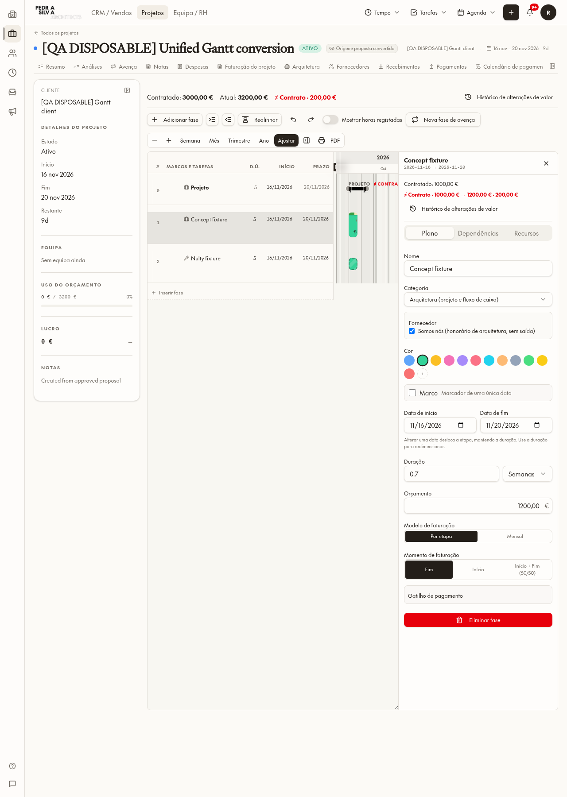
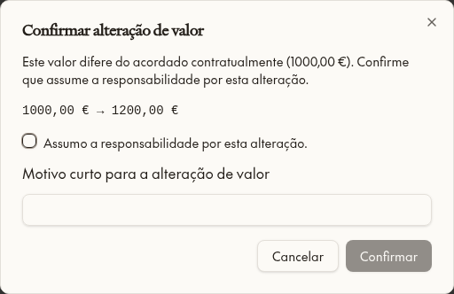

# Gantt Phase 2 report — 11 Nov 2026
- Free dates on live projects; imported allocations stay protected.
- Contracted reference is read-only; current value change needs responsibility confirmation and reason; unfrozen billing updates immediately; issued/paid rows are protected.
- ≠ Contrato, Fora do contrato, Contratado vs Atual, allocated/remaining, append-only history (real user, date, old/new, reason).
- Retainers: add month; monthly change asks whether the client agreed and applies from a current/future month.
- Migrations 0275–0277, mirrored. B1 OFF revision 10. Disposable fixtures only, all deleted.
- Verified: direct copy 1000→2000 (billing 2000, history); converted copy as Ricardo 1000→1200, proposal still 1000, history shows Ricardo.
- Not verified in browser: retainer value change/extension and substage over-limit rejection (rule in database and unit tests).

## Verification and limits
39 pure calculation/actuals tests passed; EN/PT parity and AST audit passed (zero new literals); latest harness build OK at 15:23:05 UTC. Independent read: zero disposable projects/quotes remaining; B1 OFF revision 10. Real project/proposal records were not edited. Append-only commercial audit entries from disposable tests are intentionally retained after fixture removal.

Phase 2 is not fully validated: retainer extension/forward value changes, concurrent split caps, fiscal freeze reconciliation, denied-user write/read checks and free-date forecast movement still require end-to-end disposable tests. No optional original-plan ghost bar was added. These checks must be finished before claiming full delivery.

## Files changed
- src/lib/projects/gantt-commercial.ts, use-gantt-commercial.ts
- src/components/planner/gantt-commercial-panel.tsx, project-inspector-adapter.tsx, planner-inspector-model.ts, planner-gantt.tsx
- src/components/quotes/quote-planner-inspector.tsx
- src/lib/projects/build-project-gantt-tree.ts, gantt-financial-visibility.ts, gantt-actuals.ts, use-gantt-actuals.ts, gantt-schedule.ts, use-planner.ts
- src/components/projects/gantt-chart.tsx, retainer-monitor-panel.tsx
- src/routes/_app.projects.$projectId.tsx
- src/i18n/locales/{en,pt-PT}/projects.json
- scripts/test-gantt-commercial.test.ts
- drizzle/migrations/0275_gantt_phase2_commercial_actions.sql, 0276_gantt_phase2_schedule_retainer_boundaries.sql, 0277_gantt_phase2_history_and_schedule_safety.sql; byte-identical supabase/migrations/20261111151500, 20261111152000, 20261111152500 mirrors
- src/lib/projects/AGENTS.md, roadmap.md; docs/gantt-phase2 screenshots and this report.

## Screenshots

