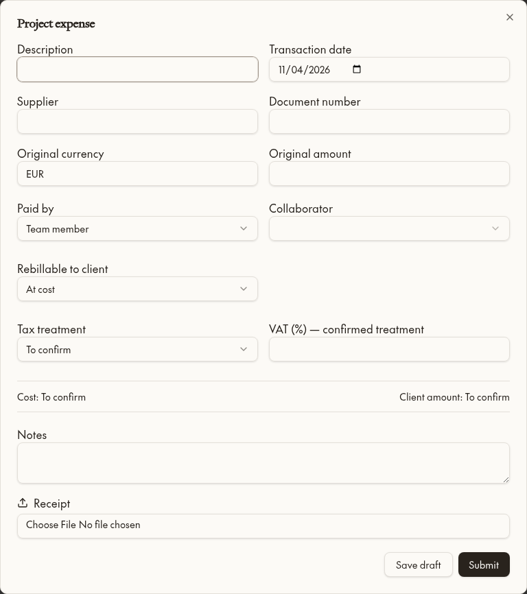
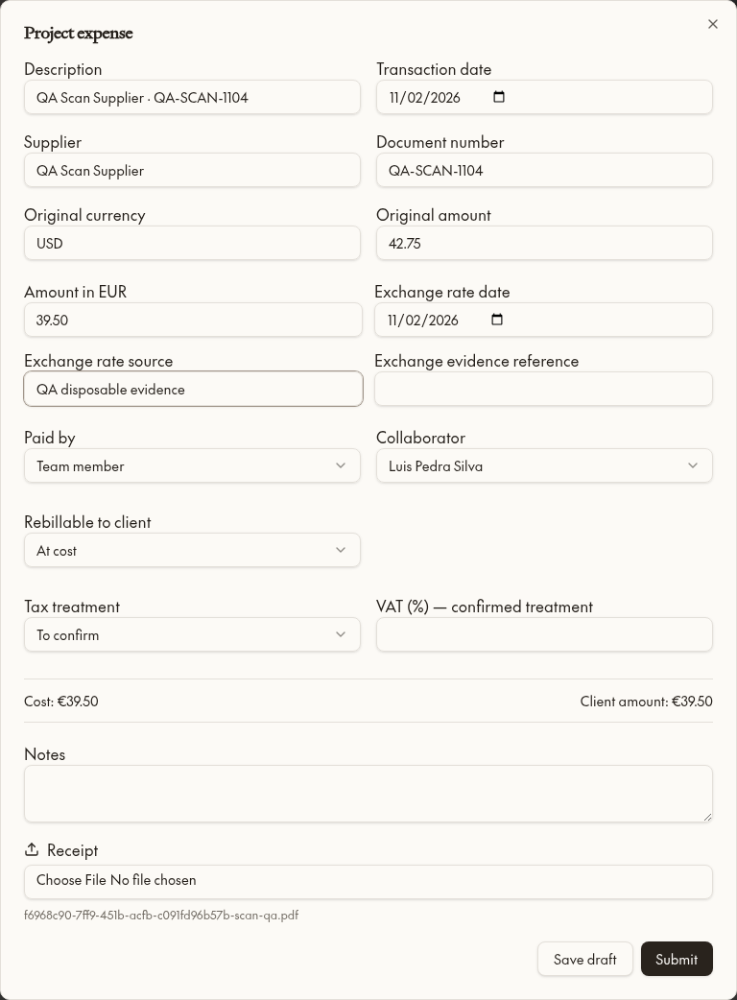
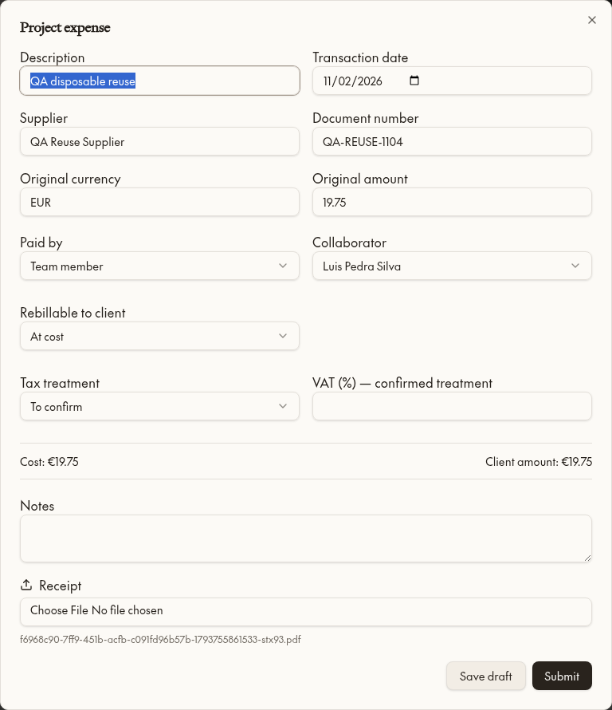
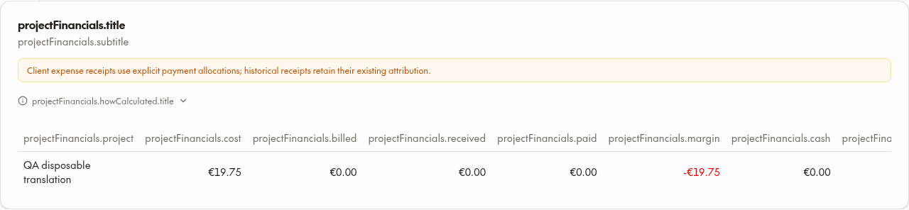
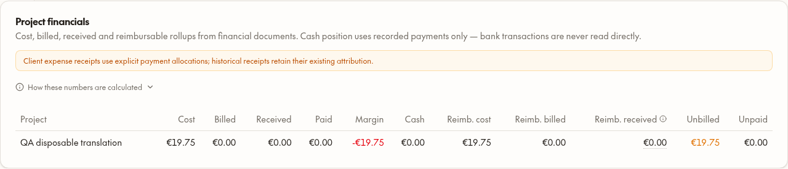
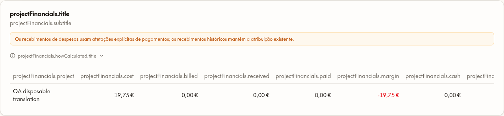
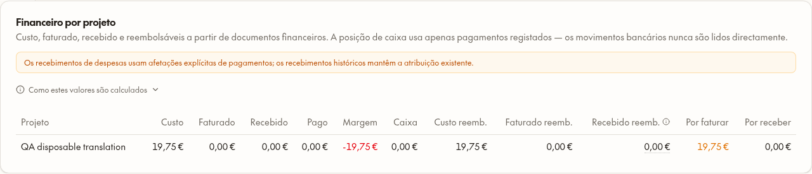

# Scan issues — 4 novembro 2026

## Resultado e limites

Corrigidos o reset do formulário de despesa, a reutilização do recibo e os caminhos/chaves de tradução identificados abaixo. Apenas dados QA foram gravados. Fase A permanece ON. Não foram alteradas permissões, custos históricos, documentos reais ou o registo Mint de 6 000 €; checks Finance recusados não foram executados.

## 1. Formulário aberto pela revisão perde os dados do scan

**Causa:** três efeitos separados inicializavam o diálogo. O efeito final repunha os valores vazios depois do efeito que aplicava fornecedor, número, data, moeda, montante e anexo.

**Correção:** uma única inicialização através de `expenseFormValues`, com evidência do scan sobre os valores base e `queueId` inicializado conjuntamente. A chamada existente da fila continua a passar `expenseIntake`; não foi alterada a confirmação fiscal.

**Verificação:** formulário real montado no navegador autenticado, com os mesmos parâmetros da fila e projeto/recibo QA persistidos. Fornecedor `QA Scan Supplier`, documento `QA-SCAN-1104`, data `2026-11-02`, moeda USD e montante 42,75 mantidos. Guardado rascunho com conversão QA de 39,50 EUR; leitura de `pm_expenses` confirmou exatamente uma despesa, montante original e caminho do recibo. Fechar/reabrir manteve prefill. Não foi chamada IA: a extração foi semeada numa fila descartável; a confirmação fiscal não foi executada. O clique completo desde o cartão da fila não foi automatizado — o teste usou o formulário e os parâmetros reais desse cartão.

## 2. Add expense volta a carregar um recibo já largado

**Causa:** `processedFile` era apagado em cada abertura, mas o pai conservava `droppedFile`. Além de duplicar Storage, o reset perdia o ID do rascunho.

**Correção:** sessão do ficheiro retém valores, ID guardado, fila e hash; cache por identidade do File **e projeto** conserva o caminho após upload bem-sucedido, inclusive se a leitura falhar. Não há reutilização entre projetos. Mantidos `upsert:false`, verificação da fila e proteção por hash.

**Verificação persistente:** ficheiro QA novo → **1 upload real**; a extração QA foi inserida pelo interceptador de teste após upload, e a função real de leitura reutilizou a fila existente. Guardar → fechar → reabrir com o mesmo File → guardar novamente: **1 upload no total**, mesmo caminho, uma despesa de reutilização (19,75 EUR), não duas. A conta final de duas despesas corresponde aos dois casos distintos. Antes, o código antigo reinicia `processedFile` na abertura; não foi repetido um segundo upload real deliberadamente para produzir um duplicado. A imagem anterior mostra o reset antigo, não uma prova visual da contagem de uploads.

## 3. Traduções — ecrãs e chaves

| Ecrã / controlo | Correção EN + PT |
|---|---|
| Painel financeiro por projeto (`ProjectFinancialPanel`) | As traduções já estavam em `finance:documents.projectFinancials.*`; foi corrigido o prefixo, sem criar cópias. O componente não tem atualmente uma rota que o monte; capturas usam montagem isolada com dados QA. |
| Faturação do projeto, pagamentos | `finance:payments.matched/manual` → `finance:documents.payments.matched/manual`, já existentes. |
| Saldos bancários, cabeçalho de verificação | Nova `finance:bank.col.snapshotCheck`: “Snapshot check” / “Verificação do snapshot”. |
| Despesas de projeto, área de recibos | Adicionado o grupo ausente `projects:expenses.drop.*` com os textos EN/PT existentes na secção forecast: emptyTitle, emptyHint, release, processing, added_one/other, unread_one/other, failed. |
| Gantt, valores financeiros da fase | Novas `projects:gantt.stage.financialsAction`, `fin.cost/sale/margin/budget/resources/vsBudget` e `gantt.milestones.laneLabel`, EN/PT. Cost e Margin referenciam o glossário. Os fallbacks antes deixavam alguns rótulos em PT mesmo na UI EN. |
| Entrada e Fila de revisão, atualizar | `common:actions.refresh` (ausente, fallback inglês) → `common:refresh`, existente. |

O primeiro levantamento estático teve falsos positivos: `docs`, `movements`, `verifyCount`, `discarded`, `documentsOverdueSummary`, `paidMissing.title`, `statementDrafts`, `createBatch`, confirmação/resultado de eliminação e resultsCount já tinham `_one/_other`; o reset administrativo usa **common**, onde as chaves existem. Não foram duplicadas nem alteradas essas traduções.

`labels.json` contém resolução no navegador em ambos os idiomas para os controlos corrigidos. Capturas comparativas do painel usam dados sintéticos; o estado “antes” foi reconstruído **apenas no catálogo em memória do navegador**, não revertendo a aplicação. A imagem `before-prefill` foi obtida da versão anterior montada isoladamente. Não apresentar a captura da rota Receivables/Payables como prova do painel, pois essa rota renderiza outro componente. Esta entrega não certifica todas as mensagens dinâmicas da aplicação nem todos os controlos por clique.

## Testes e limpeza

- 18 testes PASS: 10 novos de estado/preservação/reutilização e 8 de montantes existentes.
- Paridade EN/PT: 13 namespaces PASS; auditoria de literais: zero candidatos novos, baseline intocado.
- Compilação da preview: OK.
- Projeto QA `f6968c90-7ff9-451b-acfb-c091fd96b57b`; duas filas, duas despesas e dois objetos. Sem utilizadores, colaboradores, recursos, propostas, horas ou pagamentos novos.
- Snapshot antes da limpeza: zero fases, documentos confirmados e obrigações de reembolso. O DELETE direto das despesas foi recusado pelo guard versão 2; a transação exata e espelhada usa exclusivamente as duas linhas QA, muda temporariamente para o ramo de eliminação versão 1 e elimina-as na mesma transação. Nenhum trigger foi desativado e nenhuma linha histórica foi alterada.
- **Leitura independente 01:34:28 UTC:** projetos=0, despesas=0, filas=0, objetos=0, eventos=0, gate=true. Os objetos foram eliminados através do cliente Storage autenticado.

## Ficheiros alterados

- `src/components/finance/project-expense-form.tsx`
- `src/lib/finance/expense-form-state.ts` (novo)
- `scripts/test-expense-form-state.test.ts` (novo)
- `src/components/finance/project-financial-panel.tsx`
- `src/components/finance/project-billing-tab.tsx`
- `src/components/finance/intake-inbox.tsx`
- `src/components/finance/review-queue.tsx`
- `src/i18n/locales/{en,pt-PT}/finance.json`
- `src/i18n/locales/{en,pt-PT}/projects.json`
- `supabase/migrations/20261104013400_scan_issues_exact_fixture_cleanup.sql`
- `drizzle/migrations/20261104013400_scan_issues_exact_fixture_cleanup.sql` (idêntico)
- `AGENTS.md`, `roadmap.md`, este relatório e `docs/scan-issues/` (capturas e resultados sanitizados QA).