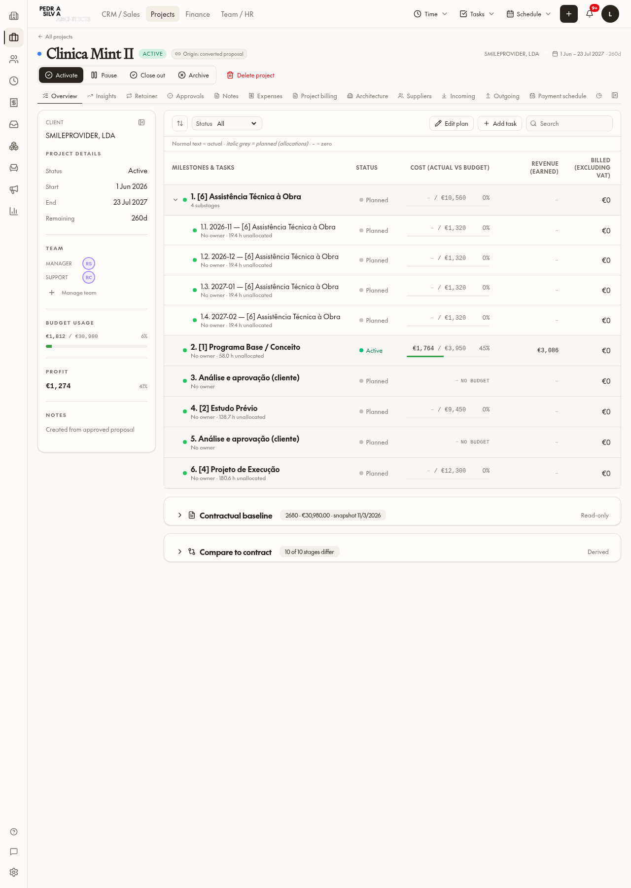
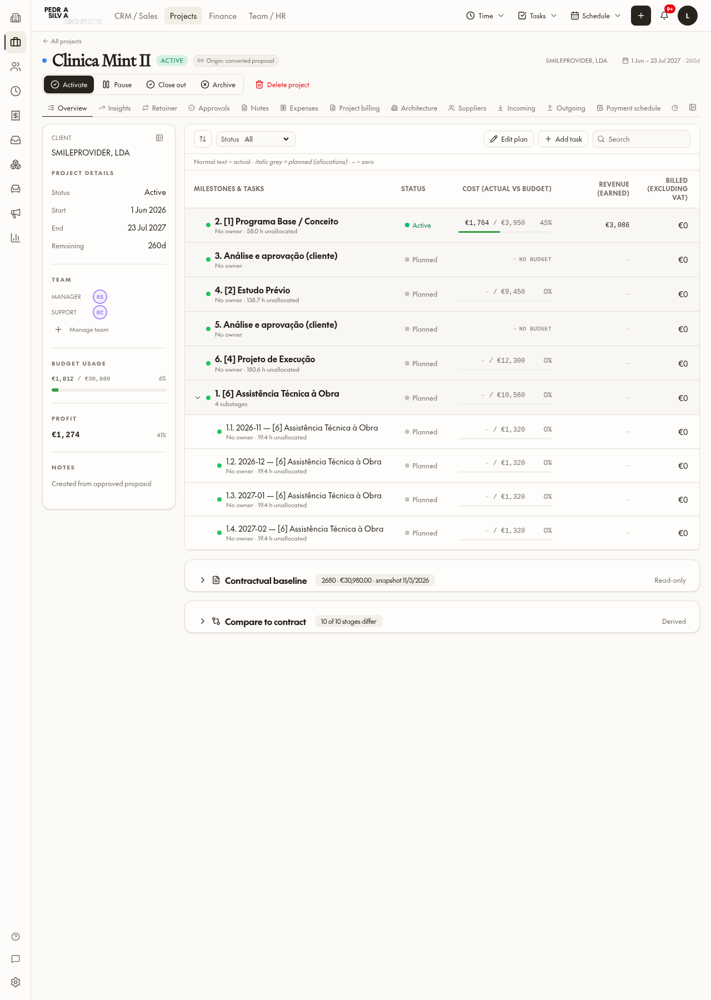

# Construction assistance display order — 5 November 2026

## Result and protected boundary

Construction technical assistance / retainer / avença appears after regular stages. Regular stages retain their original WBS order. Numbers are calculated before presentation sorting: Mint's assistance retains number **1**, while appearing below regular stages **2–6**. No renumbering, migration, stage/date/payment update or baseline rewrite was performed. B1 remains **OFF**, independently read after cleanup.

## Screens and paths changed

| Screen | Implementation |
|---|---|
| Project Overview, Milestones & tasks, cost vs budget and revenue columns | `src/lib/projects/use-planner.ts`, `src/routes/_app.projects.$projectId.tsx` |
| Project Gantt and shared planner | `src/lib/projects/build-project-gantt-tree.ts`, `src/components/planner/planner-gantt.tsx` |
| Inspector stage choices, predecessor/successor choices | `src/components/quotes/quote-planner-inspector.tsx`, project route stage options |
| Global Gantt | `src/routes/_app.projects.gantt.tsx` |
| Incoming | `src/components/projects/project-incoming-payments.tsx` |
| Project Payment schedule / Financial summary | `src/components/projects/project-financial-tab.tsx`, shared quote payment/summary views |
| Finance Invoices to issue | `src/components/finance/invoices-to-issue.tsx`; existing status/date groups preserved, stages sorted within each group |
| Insights stage selector and retainer panel | Sorted project reader feeds existing consumers; retainer-only month rows retain chronological order |
| Contractual baseline and Compare to contract | `src/components/projects/contract-baseline-card.tsx`, `contract-diff-card.tsx`; read-only stage and payment display |
| Proposal builder, payment schedule and financial summary | `src/lib/quotes/use-quote-stages.ts`, `src/components/quotes/quote-payment-schedule-tab.tsx`, `payment-schedule-proposal-view.tsx`, `quote-financial-summary-tab.tsx` |
| Proposal editor stage selectors and generated documents/PDF rendering | `src/components/psa-composer/block-settings-panel.tsx`, `block-renderer.tsx`, `src/lib/psa-proposal/live-data.ts` |
| Shared stage lists/numbering | `src/lib/quotes/stage-numbering.ts`; construction flags plus narrow legacy-name fallback, including descendants |

## Before / after evidence

Additional authenticated read-only captures: [Incoming](stage-display-order/mint-incoming-after.png), [Payment schedule](stage-display-order/mint-payment-schedule-after.png), [Financial summary](stage-display-order/mint-financial-summary-after.png), [Insights](stage-display-order/mint-insights-after.png), [Retainer](stage-display-order/mint-retainer-after.png), [Baseline and comparison](stage-display-order/mint-baseline-compare-after.png), [Global Gantt](stage-display-order/global-gantt-after.png).

Mint's complete stage rows were compared before/after by ID and are identical (`mint-stages-before.json`, `verification.json`). Browser verification had no page errors. Existing contractual dates, fee and discrepancy status were not changed.

## Disposable verification and cleanup

One disposable project at a time; no identity or collaborator created. Fixture contained assistance with sort_order 1 followed by Design 10 and Execution 20. Authenticated Overview rendered **Design (2), Execution (3), assistance (1)**. Complete stored stage rows compared equal after viewing. [Screenshot](stage-display-order/fixture-overview-after.png), [preservation evidence](stage-display-order/fixture-preservation.json).

An initial incomplete fixture insert was rejected by the stage_kind NOT NULL guard; its empty project was deleted and zero verified before the replacement fixture. Successful fixture stages and project were deleted by exact project ID. A separate fresh authenticated session independently confirmed zero projects, stages, team rows and payment rows, and B1 OFF: [independent zero](stage-display-order/independent-zero.json). No receipts, allocations, documents or baseline were created.

## Tests and limits

61 focused tests passed, including 10 new construction-order tests: original WBS preservation, regular subtree order, construction descendant placement, unchanged frozen input/date/amount data, stable instalments, legacy labels and false-positive exclusion. Translation audit/parity and existing translator tests passed; no translation keys added.

Project Overview was asserted through the rendered UI on both Mint and the fixture. Other Mint views were opened/captured read-only. Proposal/PDF ordering uses the shared renderer and was code-reviewed, but no new proposal was created and no PDF was exported in this verification. Global Gantt was captured but individual popover interactions were not automated. Screenshots are not a claim of full interaction verification for every path.

B1 activation still requires Luis's approval. B2 was not started.